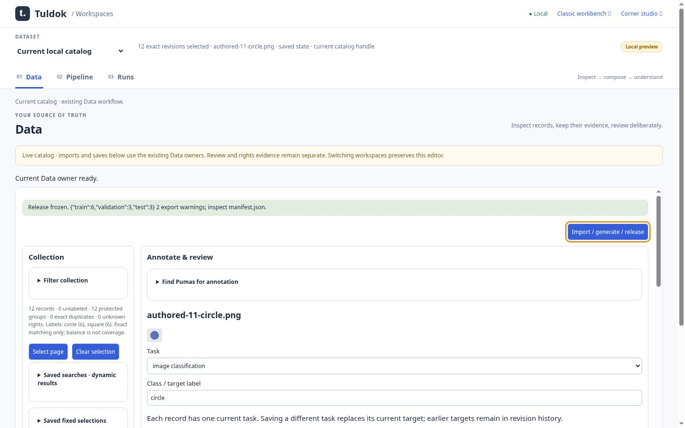

# Tuldok

A local dataset studio for turning source material into reviewed, reproducible datasets. Import images, text, audio or supported spatial data, annotate and inspect it, then freeze a release with its revisions and provenance intact.

The **Data → Pipeline → Runs** workspace keeps that process connected: prepare records in Data, edit a saved recipe in Pipeline, and inspect results and downloadable artifacts in Runs. Built-in execution covers bounded CPU image, text and audio-interval classification, plus validation and export workflows. ASR and general 3D training are not available.



*Actual app capture using authored CC0 sample drawings. [Capture source and details](docs/images/workspaces-m2/README.md); more [image, text and audio views](docs/images/workspaces-combined-20261012/README.md).*

## Run locally

The supported setup is Linux or WSL2 with Python 3.10+ and PostgreSQL 16–18 installed locally. PostgreSQL 17.11 is the tested migration version. Put PostgreSQL's tools on `PATH`, then run from this checkout:

```sh
python3 -m venv .venv
.venv/bin/pip install -r requirements.txt
.venv/bin/python scripts/local_postgres.py init
eval "$(.venv/bin/python scripts/local_postgres.py env)"
.venv/bin/python app.py
```

The helper creates a private local PostgreSQL service without a TCP listener. There is no JavaScript build step or hosted database requirement.

Open http://127.0.0.1:8091/workspaces. In a second terminal, from the same checkout, load the database environment and create a one-time login file:

```sh
eval "$(.venv/bin/python scripts/local_postgres.py env)"
.venv/bin/python access.py login --data ./data --out /absolute/private/new-login-code
```

Replace the output path with a new file in an existing private directory. Enter its code in the browser's **Session** dialog within ten minutes. Sessions last eight hours. [Access details](docs/contracts/actors.md).

For later starts, run the helper's `start` action, load `env` again, and start `app.py`. Stop the app before running the helper's `stop` action. [Storage setup, backup and recovery](docs/contracts/local-storage.md).

Existing catalogs need the explicit [schema upgrade](docs/contracts/workspace-storage.md) before use. Keep each data folder's `.tuldok.json` with its files. Native Windows is unsupported; macOS is not qualified.

## Start with your data

1. Open **Data** to import records, annotate them and save human review.
2. Select the records you want, preview a release and freeze their exact revisions.
3. In **Pipeline**, choose a compatible validation/export or classification recipe. Training needs its separate [CPU runtime setup](docs/contracts/workspace-image-training.md#optional-runtime).
4. Open **Runs** to inspect progress, results and artifacts.

The earlier dataset editor remains at `/workbench`; the book-corner capture studio remains at `/`. Tuldok runs independently of Book-Be-Gone.

The [Python workflow client and CLI](docs/contracts/workflow-client.md) export exact submission and collection manifests, monitor with finite deadlines, explicitly cancel, collect verified artifacts and delegate exact comparison through the existing local agent API. They use its private configuration and owner-issued grants.

## Go further

- [Supported formats and workflow guides](docs/README.md)
- [Open a local project](docs/contracts/projects.md)
- [Local agents and MCP](docs/contracts/agent-operations.md)
- [Execution permissions](docs/contracts/external-recipes.md)
- [Training evaluation guide](docs/research/training-evaluation/README.md)

AI assistance is optional. Inspect the selected provider and data it receives before submitting a request. Model output still needs human review.
