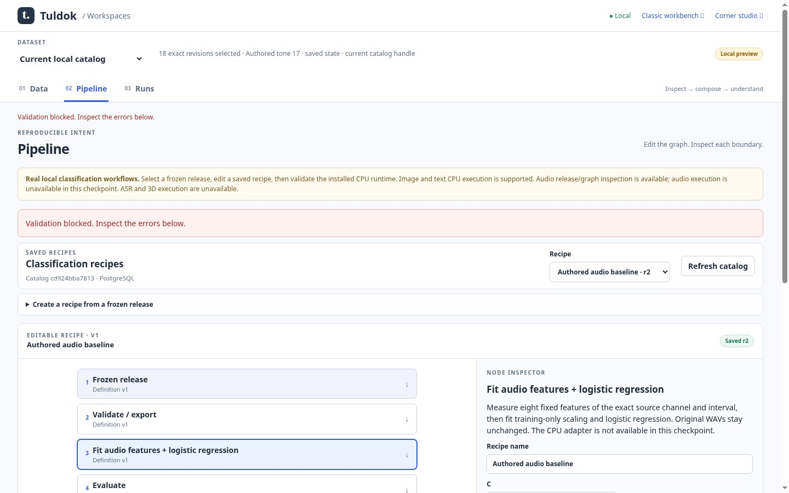
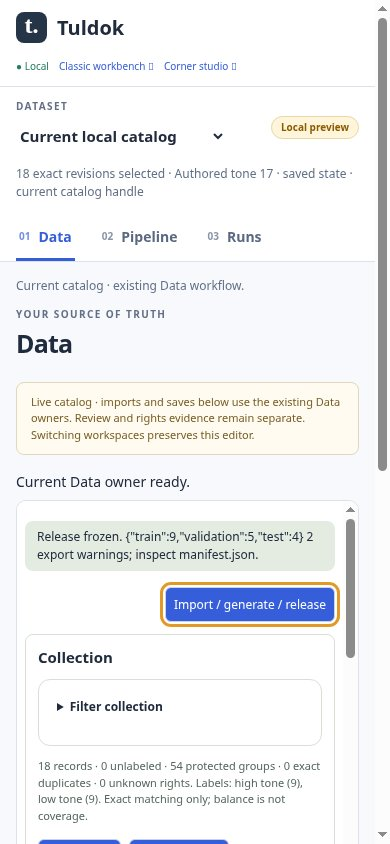

# Audio release/graph checkpoint

Original JPEG85 Chromium captures from clean source
`1959775933030a3639ad504143207d9d8d786f1d`; [receipt](receipt.json) and
[hash manifest](manifest.json). Command: `node tests/browser_workspace_audio_run.cjs`
with the installed app Python, local PostgreSQL and optional CPU environment.
Authored mathematical stereo WAVs entered through the ordinary HTTP import and
review boundary; freeze and graph editing used real browser controls.

[Desktop Data](catalog-audio-1440.jpg) · [Narrow Pipeline](pipeline-audio-390.jpg)

Four browser checks passed with no horizontal document overflow. Root and owner
visually inspected the desktop Pipeline and narrow Data captures. The narrow
Data image shows the collection/release state; the final execution milestone
will separately capture waveform and frame/channel controls. This checkpoint
qualifies release/graph behavior only. CPU execution, lifecycle and final review
remain pending; ASR is unavailable. No accuracy claim or user data.
