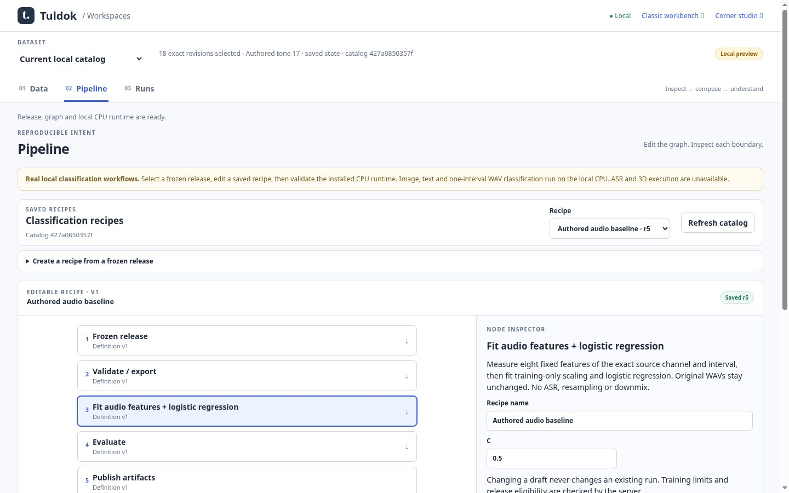
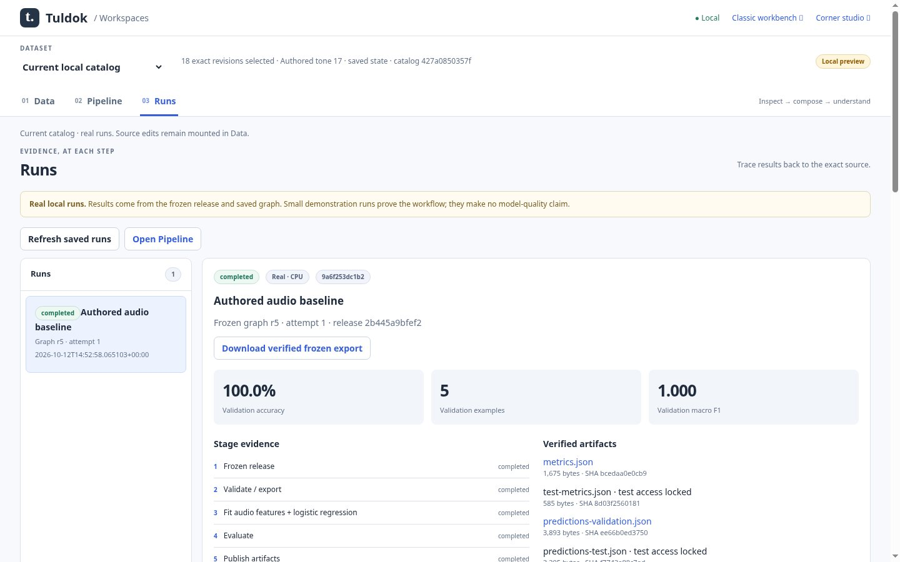

# Real bounded audio workflow

Original JPEG85 Chromium captures from clean source
`292ba880b8bdcb80a469e5d370e29e5f006929a9`, including runtime custody repair
`5db224059162e2600bb4f05d754de167f4d752f3`. The
[browser receipt](receipt.json) records all thirteen passing checks; the
[hash manifest](manifest.json) binds these fifteen unmodified captures and
supporting evidence. Chrome 151.0.7922.173 ran the actual application and local
CPU trainer against a disposable PostgreSQL catalog.

The eighteen stereo WAVs are authored CC0 mathematical fixtures from
[`classification_fixture.py`](../../../tests/fixtures/workspaces/audio/classification_fixture.py).
Import and reviewed annotation setup use ordinary HTTP APIs; release freezing,
graph editing, run submission and corrections use real browser controls. Tiny
tone metrics demonstrate operation and custody, never useful accuracy or
semantic independence. ASR remains unavailable.





| Source and results at 390 pixels | Evidence |
| --- | --- |
| Saved channel and half-open frame interval | [Waveform and interval editor](audio-source-interval-390.jpg) |
| Frozen recording, channel, frames and revision | [Prediction source references](audio-result-frames-390.jpg) |
| Completed stages and test access still locked | [Metrics and artifacts](results-detail-390.jpg) |
| Page entry states | [Data](catalog-audio-390.jpg), [Pipeline](pipeline-real-390.jpg), [Runs](results-real-390.jpg) |

Additional captures: [desktop Data](catalog-audio-1440.jpg),
[running child](running-real-1440.jpg), [1024-pixel results](results-real-1024.jpg),
[saved correction](catalog-correction-1440.jpg).

Native Chromium 200% menu zoom was verified by device ratio 1 → 2 and CSS
viewport width 1440 → 720: [Data](data-native-200.jpg),
[Pipeline](pipeline-native-200.jpg), [Runs](runs-native-200.jpg). Browser checks
found no document horizontal overflow. The implementation owner visually
inspected the final source interval, prediction, desktop graph/results and native Runs captures, including loaded saved interval fields, frozen frame
references, and native zoom controls.

Run from the feature worktree with app Python on PATH, the existing local
PostgreSQL DSN in `TULDOK_DATABASE_URL`, and the optional pinned CPU Python in
`TULDOK_TRAINING_PYTHON`:

```sh
node tests/browser_workspace_audio_run.cjs
```

This capture additionally used the existing local X11 display and xdotool via
`TULDOK_NATIVE_ZOOM=1` and `TULDOK_XDOTOOL`, plus the loopback-only libc helper
in `LD_PRELOAD`. The receipt includes twelve transport canary checks. This is
ordinary libc transport qualification, not a direct-syscall security sandbox.

[Thirteen focused audio tests](focused-audio-tests.txt) passed in 53.897s,
including actual child cancellation, supervisor death/reopen/fresh retry,
independent numerical cases and replacement after release verification.
[Independent reviewer evidence](independent-owned-capture.json) confirms that
atomic pathname replacement cannot replace the retained verified training
bytes. The reviewer independently repeated all thirteen tests with zero skips.
Root owns combined integration checks, retained image/text proofs and hosted CI;
their acceptance is distinct from these feature captures.
