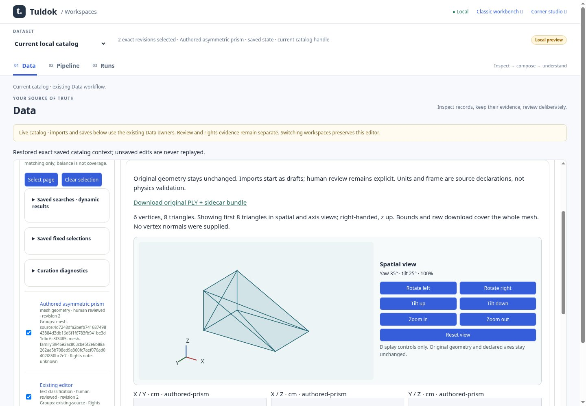
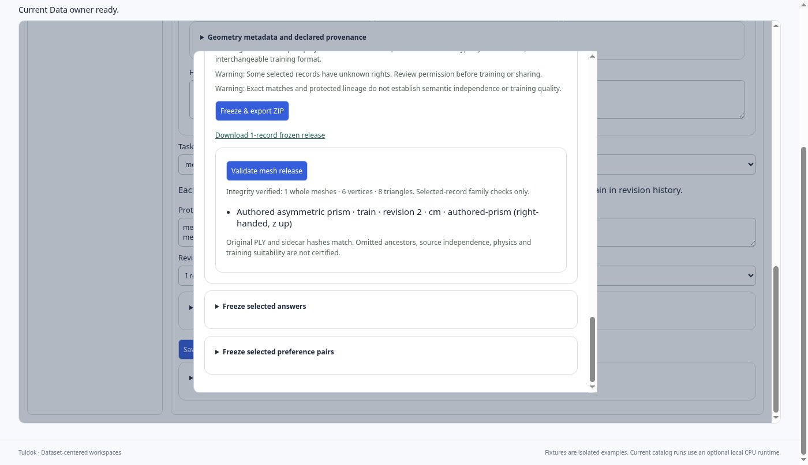

# Static mesh workspace evidence

Original JPEG85 captures from clean source
**0685d91afd195e64c5f4b1793f0a28be3d470d1d**, produced by
`tests/browser_workspace_mesh.cjs`. [Receipt](receipt.json) and
[image hashes/dimensions](manifest.json) retain the capture identity. Files were
copied without resizing or re-encoding. All four final images were visually
inspected: native geometry is legible, controls remain readable, keyboard focus
is visible at 200%, and 390px has no horizontal overflow.

The prism is an actual project-authored six-vertex/eight-triangle ASCII PLY with
mixed native property types, centimetres and declared `authored-prism` frame.
These are real application import/review/freeze/validation actions on authored
fixtures, not an external scan, physics producer, or training result.

| View | Original |
| --- | --- |
| Compact Data workspace, 1440 × 1000 | [Desktop](mesh-desktop.jpg) |
| Spatial inspector, 390 × 844 | [Narrow](mesh-narrow.jpg) |
| Frozen download and integrity report | [Validation](mesh-release.jpg) |
| Native Chromium 200% zoom, keyboard focus | [200%](mesh-native-200.jpg) |

Validation parsed the complete original geometry, verified exact source hashes,
and preserved the frozen download. [Actual report](validation-report.json)
explicitly restricts family checks to selected records; absent ancestry,
rights, scientific correctness and training suitability are not certified.
The renderer shows at most the first 512 triangles, independently of full
release validation.

Environment: local PostgreSQL 17.11, app Python 3.12, Node 24, Chromium 151,
Linux Xvfb `:91`, software-rendered Chromium with its existing QA no-sandbox
flag. Native browser zoom was set through the owned window's menu shortcuts
and proved by doubled device pixel ratio and halved CSS viewport; it was not
device-scale emulation. No user desktop or computer was used. The run inherited
the ordinary-libc loopback network guard; this is not a security sandbox or
new direct-syscall canary qualification.

The [early captures](early/receipt.json) preserve the first runnable classic
view exactly as captured. Their source was a **dirty** implementation candidate
at 2344b819, before final validation and review. They are retained development
evidence and are not substituted for the clean final source above.

See [implementation and launch evidence](../../plans/dataset-centered-workspaces/reports/m5-mesh-20261012.md).
