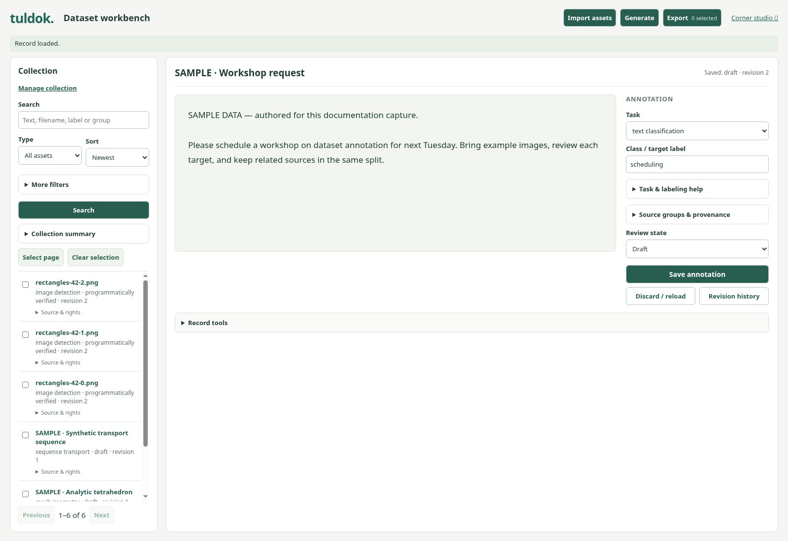
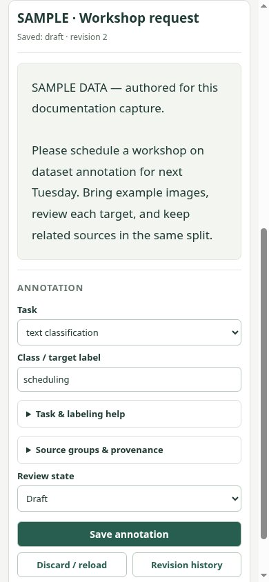

# Compact dataset workbench

The standalone dataset workbench puts a practical collection pane beside the source
canvas and annotation inspector. Import, generation, export and collection
management occupy toolbar drawers instead of a permanent third column. Exact
filters, source/rights evidence and detailed help remain available through
native disclosures. Saved review state is labeled explicitly; draft ownership,
validation, human review and release proof remain with the existing controllers.

The drawer uses native modal focus containment, Escape and a visible Close
control. Closing retains form values and running operations. Global status is
mirrored inside the modal. Invalid fields open their enclosing disclosures before
native validation focuses them. The collection marks the current record and shows
its metadata on demand. Images use the available canvas width while box
coordinates remain in original-image pixels. Narrow screens stack source and
inspector with natural document scrolling.

The reconciled presentation moves current controls into these surfaces without
cloning them. `app.py` registers the presentation script and its scoped stylesheet.
Current control IDs, native validation constraints, imports, export formats and
controller scripts are retained. The malformed Images filter option is corrected.
The current HTML remains the authoritative source for every supported modality;
its existing formatting is retained. Embedded workspace Data keeps its existing
drawer and context/edit ownership in `workspaces-data.js`.

Current reconciliation admission and gates are owned by [the plan](plan.md);
[fresh composed-code verification](reports/reconciliation-20261014.md) records
the current browser evidence.
The captured owner images and original validation below are historical evidence
from PR33's original implementation; fresh composed-head verification is recorded
separately and does not imply scientific or model-quality acceptance.

## Actual browser captures

Historical owner captures from source commit `24a91eee4071e02909b2400f0150be6537e2937f`, using
`python3 -u app.py --port 0 --data /workspace/tuldok-ui-captures/data` and
`/workbench`. Chromium 151.0.7922.173, device scale 1, JPEG quality 85. Desktop
viewport: 1600 × 1100; narrow viewport: 390 × 844. These are unedited browser
pixels, using the same isolated sample dataset as the prior documentation capture.
All four images below were visually inspected. No personal data or real inference
was used, and the displayed text/mesh records remain drafts.

| View | Before on main `1bb2c3a` | After |
| --- | --- | --- |
| Text | [Original screenshot](https://github.com/MrScripty/Tuldok/blob/83b2df92d16acb80a03d1a5d19370489b464501a/docs/images/dataset-workbench-text.jpg) | [Compact editor](../../images/compact-workbench/text.jpg) |
| Image | [Original screenshot](https://github.com/MrScripty/Tuldok/blob/83b2df92d16acb80a03d1a5d19370489b464501a/docs/images/dataset-workbench-image.jpg) | [Larger canvas](../../images/compact-workbench/image.jpg) |
| Mesh | [Original screenshot](https://github.com/MrScripty/Tuldok/blob/83b2df92d16acb80a03d1a5d19370489b464501a/docs/images/dataset-workbench-mesh.jpg) | [Wider projections](../../images/compact-workbench/mesh.jpg) |

These four selected publication assets are deliberately retained for the requested
README/portfolio presentation. Automated test screenshots, logs, ZIPs and runtime
datasets stay in ignored `build/qa/` or external output, following the QA policy.
The separate documentation PR #32 and its original assets are untouched.

## Validation

Passed locally for the historical owner implementation:

- `node tests/browser_workbench_layout.cjs`: native clicks, repeated drawer open/
  close, Escape/focus return, preserved drafts and selections, text import, native
  required-field validation inside collapsed evidence, save, keyboard exact
  filtering, release preview and ZIP download, offline generation, original-pixel
  coordinate mapping after image scaling, mesh import/projections and 390px layout.
- Existing Chromium suites: `browser_workbench`, `browser_meshes`,
  `browser_sequences`, `browser_bulk_import`, `browser_rights_note`,
  `browser_metadata_filters`, `browser_saved_selections`, and `browser_captions`.
- Workbench and combined ownership controller suites; JS syntax and
  `git diff --check`; original IDs and validation constraints compared.

The metadata keyboard test now opens More filters before focusing the field.
The controller assertion still verifies rights metadata, in its new disclosure.
The new browser test and script syntax check are included in the CI workflow.

Remaining scope: desktop collection and source areas scroll independently; narrow
screens stack the inspector below the source. Dense provenance and provider forms
remain available inside their panels. Mesh support is static projections and
bounded geometry inspection; sequence support is transport metadata inspection.
That historical implementation did not add audio or qualify pretrained inference.
The reconciliation retains current-main audio controls. Only Chromium
was exercised locally; native dialog behavior in other browsers is unqualified.

The pre-existing documentation PR32 CI at `83b2df9` completed with failure in
`node tests/browser_pumas_typed.cjs` (exit code 1); earlier test steps passed.
GitHub denied the log download with `Forbidden`, so the assertion is unavailable.
No Pumas changes or CI reruns were made as part of this layout work.
