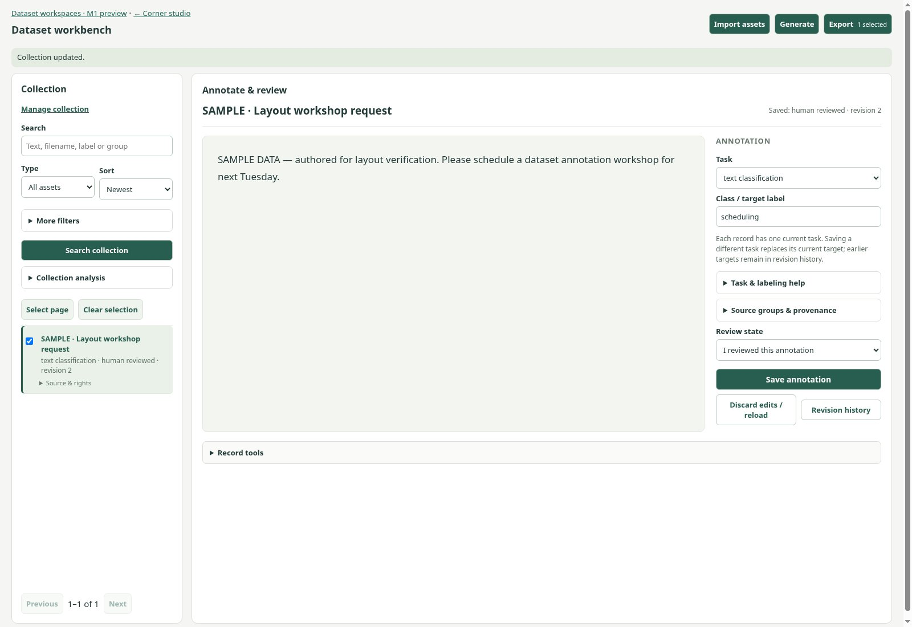
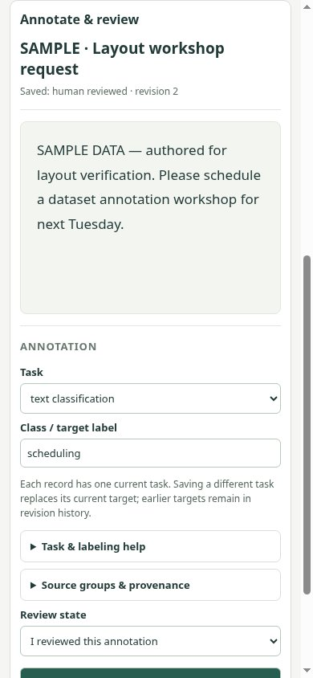

# Current-main PR33 reconciliation verification

Admitted main: `f2751c3224ed0280ba285262698d15144a8fed9f`.
Original PR33 owner: `581fa5ca471186ed641ec4bf6d134ee1ba807d22`.
Reconciliation retains both through an original-descendant merge and preserves
the owner's four publication captures. No v2/MCP implementation is included.

## Result

The standalone workbench has a compact collection pane, larger source canvas,
annotation inspector and four native modal tool panels. The current main HTML,
all supported source/import/export controls and their native validation remain
authoritative. A scoped stylesheet and one presentation adapter move existing
nodes; domain controllers continue owning edits, selections, review and release.
Embedded Data keeps its existing drawer and Data/Pipeline/Runs context owner.

[Layout receipt](reconciliation-layout-receipt.json) binds the actual tested
source files by SHA-256 and records Chromium `151.0.7922.173`, 1600×1100 and
390×844 viewports, headless software graphics, verification-only sandbox flags,
isolated authored fixtures and bounded browser/process cleanup. Its working
head is the original owner head because the merge was not yet committed; the
source hashes identify the composed code actually exercised. Hosted final-head
checks and publication remain with the serial integration owner.

[Checks receipt](reconciliation-checks.json) records **35 passing browser
gates**: the new layout gate and 34 existing suites. The new gate verifies every
served current control ID, native required/range/length constraint, kind/task/
export option and controller script; actual pointer plus native Enter/Shift+Tab/
Escape; focus restoration; preserved drafts/selections; invalid-field disclosure;
explicit review/save/release download; original-pixel image box coordinates;
mesh import/projections; and narrow content fitting.

The existing gates include the typed Pumas/caption/classification workflows,
instruction/preference consumers using actual downloaded archives, all current
imports and exports, and embedded recovery/audio/mesh/spatial/workspaces.
Embedded workspace tests retain native keyboard import/save/review and draft/
selection retention through Data/Pipeline/Runs. Fifteen affected Python tests,
eleven controller suites, JavaScript/Python syntax, whitespace checks and the
adopted plan validator also passed. Existing assertions were retained.

Independent review identified a stale current-record marker in embedded Data.
Marker creation is now scoped to the standalone owner hook. An attribute-aware
controller regression reproduces restore/refresh record A followed by opening
B without that hook; neither record receives a standalone marker. Real browser
workspace assertions also prove the embedded document has no compact shell or
standalone markers. The layout gate proves the positive standalone marker path.

## Environment resolutions and limits

The unchanged combined-browser consumer first failed because base Python lacked
`trl`. Its declared pinned packages were installed in `/tmp/tuldok-pr33-consumer`,
reading existing CPU Torch without changing either retained project environment.
The unchanged instruction/preference consumer pin/source checks passed; their
models are locally constructed random fixtures, with no pretrained download or
training. The spatial gate initially selected base Python without NumPy; rerun
using the supported `TULDOK_NATIVE_READER_PYTHON` and existing NumPy 2.5.4 /
plyfile 1.1.3 passed exact native-byte, signed-zero, voxel and affine checks.
Neither obstruction was hidden by a skip or weaker assertion.

The keyboard disclosure test required a complete CDP Enter key representation,
including its carriage-return text, to reproduce Chromium's native keypress.
The corrected input passed the same open-state assertion.

The admitted main has no P3 actor/session subsystem. This reconciliation does
not import one or bypass one. Future scientific/auth integration requires fresh
composed-head qualification. This evidence qualifies current-main Chromium UI
and existing authored transport/consumer flows, not scientific quality,
pretrained inference, assistive-technology conformance or other browsers.

## Selected actual browser pixels

Both captures below were visually inspected after the final passing layout run.
The sample text and labels are authored for QA; no personal data is present.
Other screenshots/archives remain in ignored `build/qa/`.

## Handoff

Root owns final publication, exact-head hosted checks and qualified merge.
The [independent read-only review](independent-review-20261014.md) passed;
all its remaining browser conditions have passed. This accepts the local
reconciliation artifact and its root publication handoff.
The isolated branch/worktree is retained for that review under the reconciliation
owner; no owner branch is force-pushed and no owner worktree is changed or deleted.
Root will record head reachability and cleanup disposition after integration.
