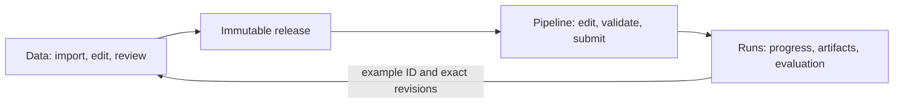

# Plan: Dataset-centered Data, Pipeline, and Runs workspaces

**Plan status:** `Active`

**Current phase:** M1 implemented on an isolated UI branch; browser, independent review and CI qualification. MB has a separate worker and is not integrated here.

**Next slice:** Finish M1 source-bound review and CI evidence, then hand off the retained branch for parent integration review. M2 remains gated on accepted MB qualification.

**Acceptance status:** `pending`

**Execution ledger:** [execution-ledger.md](execution-ledger.md)

**Issues:** [issues.md](issues.md)

This is the canonical plan for the requested new workspace experience. The original planning task authorized planning publication only. The later delegated user instruction admits M1 `start` on `ui/dataset-workspaces-m1-20261011`; the [M1 implementation record](reports/m1/implementation.md) binds that authorization and exact source. It does not authorize main merge, deployment, model acquisition or real M2 execution. Conditional integration choices remain explicit spikes. Existing feature plans retain authority for their own work.

## Objective

Make Tuldok a dataset-centered local application: people acquire, inspect, annotate, review, and freeze data in **Data**; edit and validate reproducible operations in **Pipeline**; and inspect execution, artifacts, evaluation errors, and corrections in **Runs**. Dataset identity and exact source/annotation revisions connect the three workspaces. Deliver one usable image-classification workflow through all three before generalizing execution to every modality.

The first complete workflow is: import owned images → classify and human-review → select independent families → preview and freeze `image_classification_v1` → edit and save a graph → run a bounded scratch CPU classifier → view metrics/artifacts and per-example predictions → open a validation-set error in Data, correct/re-review it, and create a new release/run. An export-only checkpoint is useful but does not close this first complete workflow.

## Objective Acceptance

These are future implementation claims, all pending. Planning/documentation checks are recorded separately in [verification](reports/verification.md); they do not satisfy product acceptance.

| ID | Observable criterion | Kind | Environment | Mode | Status | Evidence |
| --- | --- | --- | --- | --- | --- | --- |
| A1 | Runnable Data/Pipeline/Runs navigation retains dataset, selection, dirty edits, graph and run context; desktop/narrow/keyboard walkthrough has readable screenshots and labelled fixture states | user-workflow | representative | either | pending | M1 browser walkthrough |
| A2 | Real image import/review/frozen release → edited graph → CPU training/evaluation → immutable results → correction/new release works after application restart | user-workflow | representative | automated | pending | M2 browser + subprocess + consumer proof |
| A3 | Revisions, rights, family splits, transform fit scope and artifact hashes remain correct across stale edits, source changes, cancellation and restart | contract | representative | automated | pending | M2 owner tests and migration/recovery cases |
| A4 | Versioned typed graphs, named recipes, node previews, invalid connections, missing capabilities and stale validation produce the declared outcomes; fixture nodes cannot execute as real nodes | contract | not-applicable | automated | pending | M1/M2 graph cases |
| A5 | Image/text/audio/3D contracts have valid and invalid fixtures from M1; real task editors and import/review/export paths pass their modality-specific gates before advertising support | user-workflow | representative | either | pending | M3/M4/M5 walkthroughs |
| A6 | Existing corners, acquisition, proposal recovery, saved selections/searches and releases remain usable; migration/rollback preserves IDs, bytes and history | integration | representative | automated | pending | MB/M2 and affected milestone regressions |
| A7 | Each feature branch has applicable standards review, CI, consumer checks, navigation/responsive evidence and reviewed screenshots; external integrations pass pinned producer/consumer gates before enablement | release-artifact | representative | either | pending | Per-branch review record and CI |
| A8 | The supported workflow runs on one machine with outbound network disabled after local installation; metadata/artifact backup restores a usable catalog, and PostgreSQL migration preserves existing data and behavior | system | representative | automated | pending | MB local lifecycle/migration gates; M2 and later offline workflows |

## Scope

### In Scope

- Dataset-centric navigation, modality-aware schema/editor selection, shared asset/revision/provenance references, correction queues, immutable releases and protected splits.
- A small editable, typed and versioned graph, reusable saved recipes, truthful output previews, validation and execution; a persistent Runs surface with cancellation, safe retries/resume and artifacts.
- A dedicated local image trainer/evaluator adapter first; additional text, audio and 3D consumers selected from real contracts.
- Explicit prototype-to-production gates, additive migration and rollback, bounded branches, runnable milestones and screenshots before all backends are complete.

### Out Of Scope

- Main merges, deployment, paid services, credentials, user-computer access, model acquisition or real M2 training in this M1 task.
- A universal plugin framework, distributed scheduler, hosted collaboration, arbitrary shell nodes, general 3D training or claims that Pumas trains models.
- Replacing existing image storage, review history, family allocation or frozen releases merely to introduce the new UI.

## Constraints And Assumptions

### Constraints

- Verified source baseline: Tuldok `1bb2c3ae9d08432c53ddf9d4bf77fa5f62ad318c` fetched from `origin/main` on 2026-10-11. [Research](reports/research.md) pins source and competing branches.
- Main is Python/Pillow, SQLite and plain browser JavaScript, with no JS build step. Preserve the trusted local application boundary and offline workflow. The accepted local-database service adds installation/lifecycle cost, which MB must qualify; every other dependency must also earn its cost.
- Local-first means **no external network dependency**. A local PostgreSQL service is acceptable; the intended metadata target is PostgreSQL after MB qualification, while artifacts use ordinary local files. No local S3 service, remote database or broker is required.
- Current `/workbench` has richer image/text workflows and bounded mesh/sequence inspection. `/` retains the corner/book framing. Audio, the graph and Runs workspace are not current capabilities.
- PR [#32](https://github.com/MrScripty/Tuldok/pull/32) screenshot work remains intact. PR [#33](https://github.com/MrScripty/Tuldok/pull/33) compact UI is a separate draft with failing lifecycle CI at `581fa5ca471186ed641ec4bf6d134ee1ba807d22`. No failing check is waived by a local pass; no inaccessible-log retry is needed for planning.
- Do not depend on or overwrite the unmerged `feature/bounded-mesh-acquisition-20261009` stack. Reinspect its exact head and accepted contracts before any later reuse.
- Standards authority remains the repository-adopted Coding-Standards `dcc56f26e884ade260770beceba2501d3746200d`. Use its actual plan template and routed policies; record unavailable Engine MCP separately. No repository-wide standards upgrade is included.

### Assumptions

- The existing image classification export is the cheapest real first consumer. It requires at least two classes and every class in train/validation/test; the canonical dataset does not. M2 preflight must report impossible family allocation, never drop examples or break families to make training start.
- The existing TinyCNN fixture can inform a bounded trainer, but test-fixture execution is not a production run API. The run owner must qualify execution, interruption, artifacts and per-example mapping before A2 passes.
- Existing browser components can deliver M1 without a framework migration. If the graph library spike proves a separate frontend build worthwhile, record cost, license, packaging and accessibility evidence before adopting it.

## Binding Decisions

| Decision | Owner | Evidence | Supersedes |
| --- | --- | --- | --- |
| Build the visible workflow first; publish runnable UI evidence at every milestone and label all fixture responses | UI owner; maintainer accepts screenshots | User requirement; M1/M2 gates | None; existing UI remains usable during rollout |
| Preserve Dataset, Workbench, Releases and protected family semantics; reference their authority rather than duplicate it | Tuldok maintainer | Existing modules, selected-release previews, immutable assets and owner ADR | None |
| Use PostgreSQL as the intended authoritative metadata store, local initially; qualify legacy migration before new graph/run persistence. Preserve ordinary artifact files and migrate existing bounded BLOBs losslessly, without mandatory file externalization | Storage/integration owner | Explicit user preference plus [SQL-coupling audit](reports/storage-audit.md); MB gate | Earlier open SQLite/sidecar choice for M2; current SQLite remains the baseline until verified cutover |
| First complete slice uses image classification and a dedicated scratch CPU trainer/evaluator | Run/consumer owner | Existing export, actual-reader test and trainer fixture | No generic training or Pumas training assumption |
| Graph definitions and run envelopes are distinct from record annotation schemas | Graph owner | Per-record editor and pipeline have different revisions and lifetimes | No graph-as-record-editor design |
| Pin recipes, node definitions, source release and parameters on submission; editing a draft never mutates a run | Graph and run owners | Reproducibility and stale-state contracts below | None |
| Pantograph is conditional reuse behind S1, Pumas remains capability-gated inference behind existing adapters | Integration owner | Inspected producer code/contracts; no live compatibility proof | No automatic Svelte/REST/Python or training assumption |
| Real audio acquisition/review/export does not depend on ASR; 3D support is declared separately by subtype | Modality owners | Main lacks audio; bounded mesh/trajectory contracts | No generic audio/3D checkbox |

## Workspace Behavior And Shared Contracts

**Data.** Dataset selector and source/release badge remain visible above all three workspace links. The main area prioritizes records and the active editor; filters and provenance are collapsible. A saved selection is revision-bound; a saved query is a re-evaluable query, not an immutable corpus. Show scope/count and dirty state before navigation or bulk review. A single-record editor contains source, target, draft/review status, history and correction reason. Model proposals are suggestions until explicitly admitted and reviewed. Preserve source unavailable/conflict states rather than silently selecting another record. Provide direct links from split/release errors to offending records and families.

**Pipeline.** Graph canvas plus node list, typed ports, node settings, validation panel and selected-node output preview. Users can add/remove/connect/reconnect nodes, change bounded parameters, undo/redo, save a draft, clone a recipe, and inspect dependency/version changes. A keyboard-operable list/form route offers every graph action without dragging. Start with the small acyclic recipe `Frozen release → Validate image export → Train TinyCNN → Evaluate → Publish artifacts`; preview and export can also run without training. Review/correction loops return to Data as a new revision/release, not a hidden cycle in the execution DAG. Preview declares fixture/real, sample size, release identity, truncation and stale state. Preview must not silently launch a full run or call an external model.

**Runs.** List by dataset/release, graph revision, state and start time. Detail shows node attempts, validation, bounded logs, progress with unknown totals represented honestly, artifacts and evaluation. Default error exploration and correction examples to validation data. A confusion-matrix cell opens per-example predictions; a result links to both the frozen example and current editable record with revision differences visible. Historical test metrics remain tied to the old release; a correction creates a new draft and review event, never rewrites a benchmark result. Distinguish fixture metrics, actual execution metrics, and quality claims.

### Shared identity, imports and corrections

- Keep existing record IDs, source revisions, annotation revisions, original/normalized hashes, protected groups, parents and acquisition evidence. M1 can use the current catalog handle. MB establishes one persistent opaque dataset ID and a migration receipt before cross-workspace references are persisted; retrying migration reuses that identity without rekeying records. Multi-catalog switching is not an M1 requirement. Names, database URLs and absolute paths never define identity.
- A typed asset reference names dataset, record, source revision, content hash, modality/subtype and representation. An annotation reference adds task/schema version and annotation revision. Derived assets record all parents, transform implementation/version, parameters, seed and input/output hashes; one normalized asset never erases its original bytes. Hash identity is not evidence of copyright or semantic independence.
- Imports use explicitly selected local bytes and bounded manifests. Validate MIME/decoder, size, row errors, archive/path traversal, duplicate keys, finite numeric values and declared modality before admission. Preview partial failures; import retry operates on a persisted admission/result identity and reports already-admitted rows. No arbitrary server paths or implicit network fetches. Retain source URI/name, acquisition time, license/rights note, permission evidence/reference and transformations. Unknown rights stay visible; do not invent legal clearance. Review rights-policy consequences separately from annotation approval and preserve existing rights behavior unless an explicit versioned policy changes it.
- Imported annotations and provider outputs enter drafts with external provenance, not fabricated human review. Save and review use existing revision checks. Corrections retain old annotation, reason and existing actor evidence; edits reset review. New schema versions must preserve historical interpretation, declare allowed migration, and reject stale/unknown schemas rather than coerce labels.

### Modality schemas and editors

All four modalities get tiny authored, licensed fixtures and negative contract cases in M1. A fixture demonstrates the UI/contract only; it does not make an unavailable import, editor or trainer production-ready.

| Modality/subtype | Representation and editor contract | Current baseline and real completion gate |
| --- | --- | --- |
| Image | Original/oriented image identity, dimensions and pixel-edge geometry; task schemas for class, caption and detection; existing corners remain separate. Orientation/resize must transform targets or refuse. Mask/polygon tools need their own admitted schema. | Main has class/detection/caption and corners. M2 reuses class path; other editors get navigation/regression coverage in M3. Do not infer unmerged polygon support. |
| Text | Preserve original source plus current canonical NFC/LF text where the existing task requires it; code-point half-open entity spans bound to that exact revision. Instruction/response and preference roles retain explicit human judgments and their existing exact-string semantics and all parent identities. | Main has class/entities/corpus, responses and preferences. M3 exposes these in the shell and qualifies one existing real consumer at a time; no global normalization of all tasks. |
| Audio | First real scope: PCM WAV, declared sample format/rate, channels, frame count and duration. Source-sample half-open intervals `[start_frame,end_frame)`, channel selection and transcript/speaker/class task fields; seconds are display conversions. Waveform, play/pause/seek, channel controls and accessible interval/transcript form. Resampling/downmix/crop makes a derived asset with algorithm/version, rates, channel mapping, rounding/delay mapping and source interval; never relabel samples. Transcript timing is absent unless actually supplied. | No audio in main. M1 uses synthetic tones/transcripts labelled fixtures. M4 delivers local import/play/edit/review/frozen audio+JSONL export and a real reader roundtrip, independently of Pumas ASR. Unsupported codecs are refused with an explicit reason. |
| Static mesh | Vertices/faces, topology, units, coordinate frame/handedness, bounds and source/sidecar hashes. Orbit/zoom/reset plus a numeric geometry/provenance view; whole-object annotations first. | Main only bounded ASCII PLY triangle meshes. M5 can qualify richer binary mesh acquisition after branch reconciliation. Inspection is not physics/training qualification. |
| Point cloud | Point positions plus declared attributes, frame/units, point count and stable indexing for any point labels; explicit downsampling lineage. | Unmerged point-cloud work is a candidate only. M1 labelled point fixture; M5a imports/views/reviews/exports a bounded real format with index/count/hash checks. |
| Volume | Voxel dimensions/dtype, physical spacing, affine/orientation, units and value semantics; orthogonal slices and optional voxel labels tied to exact grid. Never reinterpret an array as a mesh. | Unsupported on main. M1 fixture and shape/affine negatives; S4 selects a bounded format/reader, then M5b is separately admitted. No generic medical-format claim. |
| Time sequence | Frame times/time units, ordering, entity IDs, fields, topology or grid per frame and whole-sequence family. Temporal labels cite exact intervals; resampling/windowing preserves ancestry and split. | Main has bounded whole Rheon trajectories (16×8×4, nine frames), not arbitrary animation/video/4D. M5c verifies existing scope before expanding; a whole trajectory stays indivisible. |

### Immutable releases, splits and leakage-safe transforms

Reuse `Releases.preview/create`, preview tokens and exact `(id, revision, source_revision)` selections. Freeze assets/targets, schema/vocabulary, rights/provenance, connected-family assignments, recipe and consumer versions, hashes and seed. Later edits/deletions must not mutate published bytes. Packaging remains atomic; incomplete artifacts never appear as complete releases.

Allocate protected connected components before augmentation/windowing. Include unselected bridges, deleted/legacy relatives, exact duplicates, multi-parent derivations, common subjects/sessions/documents and sequence/crop ancestry. Children inherit their family's split. Preserve explicit legacy assignments; conflicting assignments or impossible ratios are actionable errors. Similarity-assisted duplicate candidates require human disposition and do not claim universal semantic decontamination.

Fit tokenizers, learned normalization, vocabulary selection and feature statistics using training examples only. Apply the frozen fitted transform to validation/test; augment training only unless an explicitly named evaluation transform is part of the release. Validation chooses hyperparameters/checkpoints; the held-out test set is for final reporting. Record test inspection and reuse as append-only run/evaluation evidence referencing the immutable release, and visibly distinguish exposed or reused test data from a fresh holdout; never mutate the frozen release or relabel an inspected test set as fresh. The first TinyCNN uses deterministic 96×96 resize/ToTensor with no fitted statistics or augmentation. Record that transform in run provenance while release PNGs remain unchanged; this keeps the initial leakage contract small.

### Graph and execution contracts

Introduce only three new permanent owners for M2: a graph document/validator, a run store/execution supervisor, and the dedicated trainer/evaluator adapter. Existing storage, release and import owners stay authoritative. API translation belongs in `app.py`; it must not become another scheduler or schema owner.

- **Graph document v1:** graph ID, document revision, schema version, node IDs/type+definition versions, typed port connections, bounded parameters and recipe version. Layout is presentation metadata; moving a node changes saved presentation, not execution identity. Distinguish schema compatibility, semantic recipe version, optimistic edit revision and execution digest.
- **Node contract:** declared input/output task+representation+schema versions, cardinality and units, parameter bounds/defaults, capability requirements, side effects, preview limits and cancellation/retry/checkpoint support. Initial definitions are a small code-owned set, not dynamic plugins. A new modality port cannot masquerade as a generic file blob.
- **Validation:** server is authoritative for closed schemas, required ports, DAG cycles, task compatibility, resource bounds, release availability, split/rights policy, runtime readiness and stale dependency versions. Return node/port/parameter paths and source-example references where known. Keep `invalid`, `unsupported`, `unavailable` and `stale` distinct. UI projects results; no competing browser eligibility algorithm.
- **Submission:** freeze graph/dependencies/release and validate again at admission; a stale preview/validation cannot authorize execution. Use a local idempotent submission key to prevent double-click duplicate runs. This is distinct from Pumas correlation IDs. Do not replay an external effect because the browser lost a response.
- **Recipes:** save a named version of the working graph, clone before changing a used version, expose required inputs and bounded parameters, show upgrade differences. General reusable subgraphs/components wait until two real recipes need them; no marketplace or component service.
- **Run record:** run ID, attempt/parent run IDs, release hash, executable graph digest, node and adapter versions, environment/dependency versions, seed, timestamps, events, artifact references and error attribution. State transitions are `queued → running → succeeded/failed`; `cancel_requested → cancelled` requires observed local worker cessation. Crash/unconfirmed external effects become `interrupted`/`unknown`, never success or proof of cancellation.
- **Lifetime:** one bounded local worker initially, owned at application startup/shutdown; no external broker. Supervise the exact child and descendants, bound log/queue/output bytes, release resources, and publish artifacts only after checked completion. A subprocess exit alone is insufficient without artifact verification. Avoid holding metadata transactions or database locks during training or other blocking work.
- **Retry/resume:** safe pure preview/export steps can reuse only hash-verified artifacts bound to the frozen executable graph digest, upstream artifact hashes, release, node/adapter/dependency versions, parameters and seed. A retry is a new attempt, preserving failed evidence. M2 resumes completed local stages after restart; training restarts from scratch unless a future adapter explicitly supports optimizer/RNG/data-order checkpoints. UI says “Restart training” rather than claiming checkpoint resume. Unknown Pumas admission requires reconciliation or an explicit new request, never automatic replay. Browser reconnect resumes observation, not execution.
- **Artifacts/evaluation:** retain manifest, split map, logs, environment receipt, `metrics.json`, checkpoint and prediction rows. Each prediction names release, record and exact revisions, split, class mapping, target/prediction and scores. Per-example failures map to Data; node-wide failures remain node-wide. Validate bounds/hashes before rendering/downloading. Do not load arbitrary uploaded checkpoint code.

### Local deployment and later shared-server use

The complete supported Data/Pipeline/Runs workflow must run on one machine after installation with outbound network disabled. Local PostgreSQL, application HTTP over loopback, local workers and optional local inference satisfy this requirement; external services must remain optional. Package UI assets locally. Keep user-visible workflows independent of deployment mode, with honest capability/readiness errors on any machine.

The **current** layout is a WAL-mode `dataset.sqlite3` connection shared under a process-local `RLock`, image/release files, and bounded mesh/sequence bundles stored as SQLite BLOBs. It is not already a separated metadata/object-store architecture. The [audit](reports/storage-audit.md) shows significant SQLite-specific production/test coupling. Adopt PostgreSQL as the target before M2 adds persistence, subject to MB's real qualification; retain SQLite only as a legacy migration source, not a second production backend without a demonstrated requirement. Existing BLOBs may initially become `bytea`; image/release files stay in place, and new large run outputs go under the managed local data directory. No wholesale asset migration or local S3.

Keep three small logical boundaries inside the application: domain-owned metadata operations with explicit transaction ownership; managed asset/artifact reads and publication that hide file versus embedded-byte placement; and revision-checked application commands for review, release, graph submission and run observation. UI/adapters use dataset/record/release/graph/run IDs, revisions, hashes and typed outcomes, never table names or filesystem paths. Preserve source/annotation revisions, exact evidence, protected families, history and idempotent admission receipts. Explicit staged/published/failed artifact states and recovery must reconcile database metadata with file publication; a successful DB commit alone cannot certify artifact availability. These boundaries reduce coupling but do not prove backend portability.

Later shared-server deployment can put the same application actions behind one authenticated API with centrally owned metadata, managed artifacts and workers. PostgreSQL networking simplifies that option; it does not supply application authorization, conflict handling or worker coordination. The API, not browser/direct-DB clients, owns writes. Local sockets/loopback and least privilege are the initial default; changing `--host` or sharing the SQLite directory is not multi-user readiness. Shared storage or an object-store adapter is optional later. Remote drivers, Redis, distributed leases, peer sync and automatic offline merge are not implemented now; a separately admitted server milestone must qualify those obligations before advertising collaboration.

## Design Observations And Remaining Evidence

The [research report](reports/research.md) distinguishes inspected code from runnable integration. Citation or matching names are not compatibility evidence.

| Assumption or claim | Decision affected | Owner | Executable procedure | Required environment | Status/evidence |
| --- | --- | --- | --- | --- | --- |
| S1 Pantograph can be economically embedded in this Python/plain-JS application | Adopt graph UI, execution service, both or neither | Integration owner | One bounded engineering-day spike: pin producer; build minimal consumer; discover definitions, edit/save/reload, reject invalid/stale connection, preflight; for UniFFI, refresh the current graph validation summary and publish the executable-validation snapshot before session execution, then repeat validation/publication after runtime restart. Create an execution session, submit a no-model operation, inspect artifact/status, cancel and close. Record transport, package/license, build footprint and lifecycle gaps. Stop with accept/reject and exact supported surface. | Supported Rust runtime plus a demonstrated host transport; no models | Source inspected, integration pending; M1 does not wait |
| S2 Small CPU trainer is a sufficient first result path | M2 adapter and resource limits | Run owner | Validate existing export with pinned real reader, run one tiny scratch epoch in a future authorized implementation environment, verify checkpoint/metrics/prediction linkage and interrupt/restart. Measure actual time/RAM; stop when this small workflow passes or bound is disproved. | CPU Torch 2.8.0, torchvision 0.23.0, scikit-learn 1.7.2 | Fixture/test code inspected; not run in this task |
| S3 Audio sample/time mapping is sufficient | M4 storage/editor/export | Audio owner | Stereo WAV with known impulses and rates; import, select channel/interval, export, cold-read exact frames; test crop/resample mapping including end boundaries. Choose duration/byte limits from measured decoding. | Browser audio + WAV reader | Pending; no ASR dependency |
| S4 Existing 3D branch and a bounded volume format meet separate needs | M5 subtype admission | 3D owner | Reconcile current branch diff and accepted tests; for volume, pick one actual consumer and independently read an anisotropic/oriented tiny grid, verify slices and spatial coordinates. Record format/license/limits and reject unsupported forms. | Selected parser/viewer; no simulation/training | Pending; main bounds known |
| S5 Compact UI can be incorporated safely | M1 overlapping static files | UI/integration owner | Re-read PR33 current diff and check results, preserve useful layout/keyboard behavior, run new shell workflow and inherited affected browser tests on the combined candidate. | Browser and CI | Pending; PR33 CI failure visible |
| S6 Local PostgreSQL preserves existing application semantics | Metadata cutover before graph/run persistence | Storage/integration owner | Qualify local install/start/stop/reopen and supported versions; migrate complete current/older SQLite fixtures into a new DB; run all-owner fidelity, transaction, two-connection conflict/idempotency and metadata+artifact restore gates in MB. Stop with verified cutover evidence or a named blocker/re-plan; static counts provide no duration estimate. | Local PostgreSQL and selected Python driver, filesystem and browser; no external service | Source audit complete; runtime/migration qualification pending |

**Pantograph decision boundary.** At `256b6b94ece4dbbaa1fb236bc4092ad08aa63525`, `pantograph-workflow-service` owns graph and execution contracts; Svelte graph is a UI projection with Svelte 5 and `@xyflow/svelte` peers. `WorkflowRunRequest` carries workflow ID/version, typed port bindings and output targets. Graph edits use sessions/revisions. The documented flow is discovery → preflight/validation → execution session → submit/status/artifacts → close/shutdown, with binding/runtime remediation still acknowledged. For UniFFI, `workflow_graph_refresh_current_validation_summary` must allow submission, then `publish_graph_session_executable_validation_snapshot` binds the saved workflow/version and current graph/validation session before `workflow_run_session`. The attribution store is ephemeral: repeat validation and publication after `FfiPantographRuntime` restarts. Saving a graph or preflight alone is insufficient; missing/stale publication must fail closed. The frontend HTTP adapter is a frontend URL proxy, not an established Python/headless REST bridge. A generic process node is not a training lifecycle. If S1 passes, Pantograph owns graph semantics and scheduling behind one Tuldok adapter; do not retain a second semantic validator/scheduler. If it fails, keep a small Tuldok-owned fixed DAG for existing local operations and record why; defer permanent Pantograph dependencies. M1's fixture editor is disposable presentation work, not an alternative engine.

**Pumas decision boundary.** At `ad31e391dcd94c204b3fcd748cc98d27b3281e65`, selected alias/profile and `/v1/capabilities` govern typed model operations. Preserve closed options, correlation, `not_admitted`/`unknown`, capability drift and actual request/result provenance through the existing Tuldok adapters. Cancellation of transport does not prove native cessation. New inference nodes require pin/DTO/HTTP/real-runtime evidence for the specific advertised claim. Audio has an explicit experimental local Cohere path marked `production_available:false`; that does not enable production ASR in Tuldok. Neither inspected integration establishes training support.

## Evidence And Oracle Plan

| Claim | Domain | Deciding oracle | Independent authority | Unsupported domain | Intended negative failure |
| --- | --- | --- | --- | --- | --- |
| A1/A4 | UI navigation and graph projection | Browser actions, keyboard walkthrough, manual screenshot inspection; separate fixture labels | Authored scenario expectations and backend schema | Fixture metrics are not execution | Disabled unsupported node cannot submit |
| A2 | Full first workflow | Browser-produced frozen ZIP → pinned ImageFolder → scratch trainer → actual prediction rows and reopened Runs | Upstream reader and retained trainer source hash; independent artifact inspection | No accuracy/generalization claim from tiny fixtures | Missing class/split refuses before worker launch |
| A3/A6 | Durable identity, no leakage, rollback | Legacy SQLite → PostgreSQL migration, two independent DB connections, filesystem reopen and complete backup/restore; independently enumerate family intersections and hashes | Existing release/family contracts and authored parent graph | No semantic dedup guarantee | Stale revision, tamper, cross-split parent or train-fit leakage is named |
| A4 | Graph contracts/lifecycle | Serialized valid/invalid fixtures and process interruption | Selected graph owner; producer DTOs if S1 passes | Mock services do not qualify native runtimes | Wrong port/schema, cycle, stale dependency and uncertain completion stay distinct |
| A5 | Modality semantics | Tiny decoded pixels, Unicode cases, known audio impulses, mesh topology, point indexes, grid affine and sequence times | Exact format readers and source contracts | Unimplemented subtypes remain unavailable | Wrong units/rates/channels/shape/intervals fail their specific rule |

## Simplicity And Ownership Review

**Applicability:** `applicable`

- Independent concepts and dimensions: Data owners acquire/review persistent records locally; graph owner stores editable operation intent; run owner supervises a submitted immutable snapshot; adapters satisfy specific consumers. UI presents each at different times and links them by stable references. Annotation/review work is not graph layout or worker state.
- State, identity, value, time, policy, and mechanism: Existing Dataset/Workbench own bytes/reviews; Releases owns frozen membership/splits; graph owns document semantics; run owns attempts/artifacts. Cross-owner values are IDs/revisions/hashes, never ambient mutable selection. Schema version interprets bytes, recipe/node version names executable meaning, edit revision prevents stale writes, digest binds execution. Current legacy consumers and new shell overlap intentionally until cutover; no exported v1 contract changes in place. Source/annotation changes invalidate previews and future submission, not old releases/runs; layout-only edits do not invalidate execution results.
- Caller and composition-root knowledge: `app.py` constructs existing owners plus graph/runs; routes pass validated IDs, requests and typed outcomes. UI knows display contracts and actions, not database tables, training commands or Pantograph runtime details. Metadata connections/transactions have an explicit owner; workers do not borrow an ambient shared connection. A trainer receives a checked immutable release path/manifest and bounded config from the run owner, never a caller command/env/cwd.
- Representative change paths and forced owners: Add audio task → audio owner, task editor and its consumer tests; graph only adds a definition if executable. Change trainer metrics → adapter and Runs renderer/schema. Change graph engine → graph/run boundary adapter, not Data storage. Change split policy → Releases and family tests, not node-local implementations. If a routine modality change touches all owners, revisit the composition.
- Stable Interfaces versus hidden knowledge: Pass explicit asset/annotation/release references, versioned graph documents and run/artifact DTOs. The existing Dataset lock/SQLite dependency is the migration source, not the target concurrency model. MB replaces it with explicit PostgreSQL transaction scopes and proven revision/idempotency behavior; file publication remains separately owned. Pantograph session/version ordering and Pumas outcome meaning must be contained in their adapters, not repeated by callers.
- Independent evolution, testing, failure, and replacement: Import/review works without training or inference installed. Invalid graph never starts a worker; failed run leaves data/release intact. Viewer failures have metadata/download fallbacks with accurate status. Optional graph-service failure cannot disable Data. Replacing a supported serialized contract needs migration/consumer evidence, not an assumed adapter equivalence.
- Deletion and cumulative machinery result: Without graph owner, version/port validation spreads into handlers; without run owner, process lifetime and publication spread into UI/adapters; without trainer adapter, consumer-specific arguments/class mapping escape into generic execution. Keep those three bounded owners. Delete generic registry, event bus, duplicated asset catalog, dual production database layer and dynamic plugin system from the proposal. A small metadata/transaction boundary contains existing persistence semantics; a generic portability framework would add obligations without qualifying migration. A failed S1 removes the external adapter/dependency rather than retaining a dormant integration layer.
- Necessary complexity and containment: Revisions, family leakage, process uncertainty and durable artifacts are inherent; contain them in existing owners and the three small additions. UI uses existing framework first. PostgreSQL is one qualified local metadata service, not a new domain authority or shared-collaboration guarantee. Heavy CPU training packages are an optional isolated runtime, not base application dependencies. General subgraphs, multiworker scheduling and more trainers need demonstrated use after A2.

## Milestones

Every milestone delivers a runnable browser path before its backend expansion is considered accepted. M1 and MB qualification can proceed independently; accepted MB cutover precedes M2 graph/run persistence. M2 completes the first workflow before M3–M5 production expansion. M3 and M4 may proceed independently after M2 against agreed contracts. S1 may run alongside M1 as a bounded investigation, without delaying its demo. Write sets below are the proposed implementation boundaries; refine exact test/module names at admission without broadening responsibility silently.

### Milestone 1: Visible three-workspace experience

**Goal:** Review a usable shell and editable graph before committing to more backend machinery.

**Allowed write set:** `static/workspaces.html`, `static/workspaces.js`, `static/workspaces.css`, `static/pipeline-editor.js`, `static/runs-view.js`; narrow navigation additions in `static/index.html`, `static/workbench.html` and route serving in `app.py`; `tests/fixtures/workspaces/`, `tests/browser_workspaces.cjs`, `tests/test_workspace_contracts.py`; narrow `.github/workflows/tests.yml` registration for those checks; this plan's reports and README entry.

**Tasks:** Reuse current Data panels behind an opt-in route; keep current root/corners accessible. Add dataset/selection context and dirty-edit protection. Implement fixture graph editing/save/reload and Runs navigation in an isolated demo store, including error/cancel/empty/unknown screens; visibly label fixture execution and never admit demo results into real datasets/releases. Define small versioned example contracts and valid/invalid fixtures for image/text/audio plus mesh/point-cloud/volume/sequence variants. Present unavailable operations with reasons; no fake success fallback. Capture desktop and narrow states before backend implementation continues.

**Acceptance gate:** Run local app and `node tests/browser_workspaces.cjs`; test navigation/back/reload, editable nodes and connections, stale validation and dirty-state handling. Manually inspect JPEG85 screenshots at 1440×900, 1024×768 and 390×844; keyboard-only import/record/form/graph-list/run navigation, focus restoration, zoom 200%, readable errors and no whole-page overflow. Store captures in ignored `build/qa/` with source revision and fixture labels. M1 passes A1's prototype scope, not A2. Replan if fitting the shell requires a framework rewrite or discards working editors.

**Status:** `Verifying`

M1 source, screenshot and verification evidence: [implementation record](reports/m1/implementation.md). The fixture service and opt-in Data adapter are presentation boundaries; no storage migration or real run API is included.

### Milestone MB: Qualify and migrate local metadata to PostgreSQL

**Goal:** Existing real workflows work locally on the intended metadata store before graph/run tables expand SQLite coupling.

**Allowed write set:** Proposed `metadata.py`, `migrate_sqlite.py`, `docs/contracts/local-storage.md`; current SQL and transaction owners `app.py`, `workbench.py`, `immutable_assets.py`, `dataset_releases.py`, `bulk_import.py`, `caption_import.py`, `caption_proposals.py`, `curation.py`, `grounded_candidates.py`, `native_detection_import.py`, `native_text_import.py`, `preferences.py`, `saved_searches.py`, `saved_selections.py`, `sequence_batch_import.py`, `synthetic.py`, `text_classification_proposals.py`; `requirements.txt`, the affected existing `tests/test_*.py` database cases, new `tests/test_metadata_migration.py` and `tests/test_metadata_transactions.py`, browser fixture setup, `.github/workflows/tests.yml` PostgreSQL isolation, README and this plan's evidence. Freeze exact packaging files/version choices at S6 admission; no user credentials in Git.

**Tasks:** Qualify local server/driver lifecycle and versioned schema, then migrate from an untouched complete SQLite+artifact backup into a new database. Keep source application writers and artifact mutators quiesced from final snapshot through verification and the authority switch; a failed cutover resumes the untouched source. Online migration needs a separately admitted delta-capture/reconciliation design. Convert SQLite-specific SQL/schema/order/error handling and explicit nested transaction ownership; preserve exact evidence text, IDs, history, deleted lineage, rights, receipts, assets and hashes. Do not blanket-convert JSON to JSONB or strip NUL; select a lossless representation or stop preflight. Existing BLOBs can map to `bytea`. Add persistent dataset identity, managed path-independent references and publication/recovery receipts only where required by the current workflows. No dual-write or dual production backend.

**Acceptance gate:** Real current and older fixtures cover every metadata owner; independent comparison verifies values, ordering, hashes and references. Prove nested commit/rollback, preview savepoint rollback, lost post-commit responses, and stale-save/idempotency behavior using two independent DB connections. Run existing import/edit/review/select/preview/release/reopen/proposal recovery with equivalent assertions, replacing SQLite-only test mechanics without weakening them. Isolate PostgreSQL test databases in CI. Demonstrate offline local startup/shutdown/reopen, complete metadata+artifact backup/restore and browser screenshots of the existing working UI. Switch only after verification; preserve the source backup. Replan on unsupported retained values, altered snapshot semantics, unqualified lifecycle or unbounded migration scope; do not estimate delivery days from static call counts.

**Status:** `Planned`

### Milestone 2: One complete real image workflow

**Goal:** A person uses all three workspaces to produce and inspect a real bounded result.

**Allowed write set:** `pipeline.py`, `runs.py`, `image_training.py`, `requirements-training.txt`, `docs/contracts/workspace-pipeline.md`, `docs/contracts/workspace-runs.md`; focused integration in `app.py`, existing `workbench.py`/`dataset_releases.py` only where reference/admission APIs require it; M1 UI files; `tests/test_pipeline.py`, `tests/test_runs.py`, `tests/test_image_training.py`, `tests/browser_workspace_image_run.cjs`, `tests/fixtures/workspaces/`, affected `.github/workflows/tests.yml` registration; README and plan reports. Preserve `tests/fixtures/train_image_classifier.py` and its pinned hash as an oracle; production adapter is separately owned.

**Tasks:** After MB acceptance, persist graph/run metadata additively in PostgreSQL and large artifacts in managed local files; implement release-validation/export nodes first and immediately show real preview/artifacts in Runs. Then add the closed TinyCNN CPU adapter/evaluator, bounded worker and result linkage. Pin Torch 2.8.0/torchvision 0.23.0/scikit-learn 1.7.2 in an optional runtime with an explicit install procedure; no pretrained path, model download or automatic environment installation. Add per-example prediction output and lifecycle support absent from the historical trainer fixture. Keep all advertised M2 graph nodes real. Implement safe completed-stage reuse, fresh training attempts and explicit interruption/cancellation semantics.

**Acceptance gate:** Browser imports/reviews a small two-class corpus with independent families and valid coverage, previews/fixes a split blocker, freezes/downloads a release, changes an actual trainer parameter in the graph, saves/reloads/submits, observes the real child, and opens metrics/checkpoint/logs/predictions. Correct one validation example through a result link and produce a distinct new release without changing old hashes. Inspect/reuse a test example in a separate negative scenario and verify its visible exposed/reused status cannot be presented as fresh holdout evidence. Repeat after application restart with outbound network disabled; verify duplicate submit, lost acknowledgement, graph edits during execution, late responses, worker failure, cancel/confirmed drain, interrupted training restart, artifact tamper and stale source/graph. Actual pinned ImageFolder and a scratch CPU epoch are required in the later implementation environment; fixture values cannot satisfy this. Capture real Data/Pipeline/Running/Results/correction states before acceptance. Replan if bounds, dependency footprint, consumer compatibility or chosen graph transport invalidate this small path.

**Status:** `Planned`

### Milestone 3: Existing image/text breadth and reusable recipes

**Goal:** Existing useful dataset tasks fit the shell without lost editing/history, and users reuse a validated recipe.

**Allowed write set:** M1 UI files; narrow integrations in existing `static/workbench.js`, `static/caption-proposals.js`, `static/instruction-responses.js`, `static/preferences.js` and `static/text-classification-proposals.js`; `pipeline.py`; `tests/browser_workspace_text.cjs`, `tests/test_pipeline.py`, existing affected consumer tests; new task-specific contract/recipe fixtures under `tests/fixtures/workspaces/`; README, CI gate registration and plan reports. Any new external text trainer requires a separately admitted adapter write set.

**Tasks:** Carry class/entities/corpus/captions/responses/preferences through Data and existing export adapters. Save/clone named recipe versions with previews and explicit upgrade differences. Use real current text export/consumer paths; introduce inference nodes only behind current Pumas capabilities and preserved draft/review semantics. General subgraphs require a second real reuse case.

**Acceptance gate:** Browser text edit/review/release/recipe run/export and exact-string/Unicode consumer checks; negative stale spans and draft targets; recipe edits leave old run results unchanged. Existing corner/image/proposal recovery regressions and desktop/narrow/keyboard screenshots. This does not claim a new text trainer or model quality. Replan when a consumer needs a different text normalization or role schema.

**Status:** `Planned`

### Milestone 4: Real audio data workflow

**Goal:** Audio becomes usable local data with timing-correct review/export, without requiring ASR.

**Allowed write set:** `audio_assets.py`, `audio_export.py`, `static/audio-editor.js`, `docs/contracts/audio-data.md`; bounded integrations in `workbench.py`, `immutable_assets.py`, `dataset_releases.py`, `app.py`, M1 UI and `pipeline.py`; `tests/test_audio_data.py`, `tests/browser_workspace_audio.cjs`, audio fixtures and reader check under `tests/fixtures/workspaces/`; README and affected CI gates.

**Tasks:** Apply S3 limits and frame semantics; import PCM WAV, render waveform/channel/interval editor and transcript/class drafts; review and freeze original bytes plus versioned targets/provenance. Add a real validation/export recipe and Runs artifact preview. Resampling/augmentation is a separate explicit derived operation. ASR stays unavailable until a later adapter proves the selected Pumas production contract and actual runtime; no experimental readiness override.

**Acceptance gate:** Known stereo impulses prove channel and interval accuracy through import, playback controls, edit/review, frozen export and independent reader; reject mismatched rate/frame count, invalid timestamps, unsupported encoding and unreviewed targets. Show duration/channel metadata and provenance in all three workspaces; keyboard transcript editing and narrow viewport captures. Replan for compressed-codec or alignment requirements beyond the selected WAV scope.

**Status:** `Planned`

### Milestone 5: Separate spatial and temporal workflows

**Goal:** Each advertised 3D subtype has a real bounded import/inspect/review/export path and explicit limits.

**Allowed write set:** First reconciliation report in this plan; then separately admitted subtype branches. M5a mesh/point-cloud: existing `meshes.py`, `static/meshes.js`, `immutable_assets.py`, `workbench.py`, `dataset_releases.py`, `app.py`, selected upstream point-cloud modules/tests only after review. M5b volume: proposed `volume_assets.py`, `static/volume-editor.js`, `docs/contracts/volume-data.md`, `tests/test_volume_data.py`, `tests/browser_workspace_volume.cjs`, narrow owner integrations. M5c sequence: existing `rheon_sequence_contract.py`, `sequence_assets.py`, `rheon_sequences.py`, `sequence_batch_import.py`, sequence UI/tests and narrow graph/run integrations. Each also owns its tiny fixtures, consumer gate and screenshot report; no wholesale import of the unmerged stack.

**Tasks:** Reconcile current heads, retain original geometry/sidecars and sequence field semantics, expose metadata fallback and subtype-specific views. Implement only the format admitted by S4 for volumes. Add distinct validate/export nodes and consumer adapters as qualified; never relabel mesh/point cloud/grid/sequence data to fit another node. Whole meshes/trajectories remain family-indivisible; spatial chunks and temporal windows need explicit lineage if later admitted.

**Acceptance gate:** Per subtype, browser import → view and metadata → review → graph validation/export → Runs download → independent native reader, with topology/index/affine/time/unit/hash assertions and malformed bounds cases. Test resets, non-drag controls and narrow views with screenshots. “3D complete” is not one gate: M5a, M5b and M5c each remain pending until their evidence passes. Replan if branch reconciliation changes storage authority or a consumer needs simulation/physics semantics.

**Status:** `Planned`

## Migration, Dependencies And Merge Readiness

**Migration/rollback.** M1 is opt-in and needs no data migration. MB imports from an untouched complete backup into a new PostgreSQL database and switches only after all-owner verification; M2 then adds graph/run metadata there. Keep source application writers and artifact mutators quiesced from the final consistent SQLite+file snapshot through verification and authority switch, including referenced image/release files and BLOBs; copying a live `.sqlite3` file alone is not a backup. A failed cutover resumes the untouched source; no online migration is assumed. PostgreSQL `pg_dump` does not include artifact files or cluster roles: a restore manifest must include file hashes, schema/server/driver versions, required roles/privileges and other restore prerequisites, with secrets kept outside Git. Restore a copy and execute the real workflow. Preserve IDs, exact bytes/history and unknown-version refusal. Artifact publication is atomic locally with explicit metadata/recovery states. Before any post-cutover application writes, cutover can return to the untouched source; after such writes, rollback must retain and reconcile/export them before using an older store/binary, never simply point the old binary at stale SQLite. Disabling new routes/workers must not delete data. Retention refuses removal of referenced releases/artifacts. Switch `/` only after A2 and legacy navigation evidence, on its own reviewed UI boundary.

**Dependency budget.** M1 uses the current Python/Pillow/browser stack. MB qualifies a supported PostgreSQL release and Python driver, local installation/lifecycle/least-privilege setup and backup tools; exact stable versions and supported OS are evidence-gated. M2 adds the isolated CPU training environment and whichever graph choice passes S1; do not install the unrelated full instruction/TRL verification environment into the app. Pantograph brings Rust/binding packaging and optionally Svelte 5/XYFlow/build tooling; list versions, license compatibility, reproducible build, memory/startup cost and supported OS before adoption. Audio WAV can start with a bounded standard-library reader and browser playback; codec/DSP libraries need S3 evidence. Point/volume parsers and rendering libraries require size/format/license review at S4. No external network service is required for the first workflow; the qualified local PostgreSQL service is intentional.

**Every merge candidate.** Refresh main and dependent heads, inspect diff and ownership, resolve overlaps serially, run focused invariant/contract tests plus affected browser and consumer gates, then the registered offline suite and required CI appropriate to the feature. Retain screenshot source revision, command, viewport, fixture/real status and manual findings. Test keyboard focus, navigation/back/reload, responsive overflow and dirty edit/stale response races. Address independent review and actionable CI/bot findings; inspect final staged diff and verify remote commit. Required failing/unavailable evidence keeps the candidate unready. New behavior must have a test that actually reaches it even under a pre-existing failure; unchanged failure counts are not evidence. No broad failure suppression or private test readiness bypass. This planning branch runs docs checks only; it does not run training-bearing aggregate tests.

## Blockers

- M1 is authorized and implemented on its own branch; final review/CI evidence remains its qualification gate. Local PostgreSQL migration/lifecycle acceptance remains a prerequisite to M2 persistence; the separate migration branch is not presumed accepted or integrated.
- Standards Engine MCP is unavailable in this environment. The source-based template/validator/review evidence is reported precisely; do not claim an Engine route or certificate.
- PR33 lifecycle CI is failing; any reuse needs a current resolved result or a separately diagnosed integration candidate. PR32 also currently reports lifecycle failure; its screenshots are preserved as branch work, not proof of this plan's future UI.
- Pantograph embedding and production audio inference are unqualified for Tuldok. They block only their respective adapters, not M1 or local audio data work.

## Re-Plan Triggers

- Fresh main or open-branch changes alter ownership, persisted data or the selected first consumer.
- MB cannot preserve SQLite-retained values, transactions, receipts or backup/restore semantics, or local PostgreSQL lifecycle is impractical; replan before adding graph/run persistence, not by silently keeping two production backends.
- S1 cannot provide a supported host boundary within the bounded spike; choose the small local graph before building around assumptions.
- A split, normalization, geometry or time contract cannot preserve current sources/labels; replace the admission design before coding around it.
- CPU dependency/resource costs make the first path impractical; compare a lighter real text baseline while retaining all three workspace outcomes, not a fixture-only substitute.
- UI feedback shows the proposed navigation hides essential review/context or cannot be operated by keyboard/narrow screen.
- A run cannot reconcile side effects or process cessation; disable retry/resume for that operation instead of fabricating success.
- Routine changes require duplicate validators, parallel storage authorities, generic registries or widespread edits; repeat the composed-design review and reduce the design.

## Concurrent Work

The maintainer/integration owner serializes shared schema, route, storage, CI, lockfile and plan changes. Independent read-only research/review may run concurrently; no competing edits to this plan. Later modality branches can work concurrently after M2 only when their contract owners and shared integration changes are assigned explicitly.

| Owner | Primary write set | Adjacent write set | Forbidden/shared | Output/report | Integration order |
| --- | --- | --- | --- | --- | --- |
| Planning author | This plan directory and one README link | None | Product code, prior plans, PR32/33 branches | Plan, source research, verification, publication | Current task |
| Independent reviewer | Read-only; report via handoff | None | All tracked files | Findings and standards review | Before plan publication |
| UI owner, future | M1 static files/tests | Narrow approved route/navigation changes | Storage and other feature branches | Runnable screenshots and interaction evidence | M1, then M2 UI |
| Storage/integration owner, future | MB SQL owners, migration and transaction tests | Serial packaging/CI/fixture setup | Others’ runtime or modality semantics | Local lifecycle, migration, two-connection and restore evidence | Independent of M1; before M2 persistence |
| Run/contract owner, future | M2 graph/run/trainer files/tests | Serial shared integrations | Modality schema changes | Complete real first workflow | M2 before breadth |
| Modality owners, future | M3/M4/M5 admitted subtype files | Shared changes via integration owner | Others' schema/lockfile/CI edits | Contract/reader/browser evidence per subtype | After M2 and stated spikes |

## Repository Isolation

Planning branch: `docs/dataset-centered-workspaces-plan-20261011`, based on the verified main SHA above; responsible owner is the planning author, target is `main` for review only. Push the branch and retain it; no main merge, branch deletion or history rewrite. This checkout is `/workspace/Tuldok`; no task-created worktree needs cleanup. Research clones are retained local read-only context, not repository dependencies.

Suggested bounded feature branches: `ui/dataset-workspaces`, `feature/local-postgres-metadata`, `feature/workspace-image-runs`, `feature/workspace-text-recipes`, `feature/workspace-audio-data`, and separate `feature/workspace-mesh-pointcloud`, `feature/workspace-volumes`, `feature/workspace-sequences`. Branch names are proposals, not created resources. Each can merge when its own useful outcome and required checks are ready under later merge authorization; do not hold M1 until all backends exist. Dependent branches may temporarily target their prerequisite for review and must retarget/revalidate after it lands. Rebase/merge mechanics and history follow Commit standards and current user authorization; no automatic main merges. The maintainer resolves overlaps with PR33 and the 3D stack after fresh inspection; the plan does not make either a mandatory parent.

## Final Acceptance

- Acceptance status: `pending` for implementation; all product claims remain open.
- Planning evidence: [research](reports/research.md), [verification](reports/verification.md), [independent review](reports/independent-review.md).
- Existing durable ownership decision: [Dataset workbench ADR](../../decisions/dataset-workbench.md). Storage cutover ADR/runbook is finalized with MB qualification; the graph/run ADR follows S1/M2 admission. The new local-first/PostgreSQL decision is recorded here until then.
- Deferred follow-ups: production ASR, extra training adapters, generic reusable subgraphs and expanded spatial/temporal formats; owners and revisit gates above.
- Current overall status: `Active`; M1 prototype qualification does not satisfy real execution, migration or production modality acceptance. The [M1 report](reports/m1/implementation.md) records the bounded delivered behavior.
