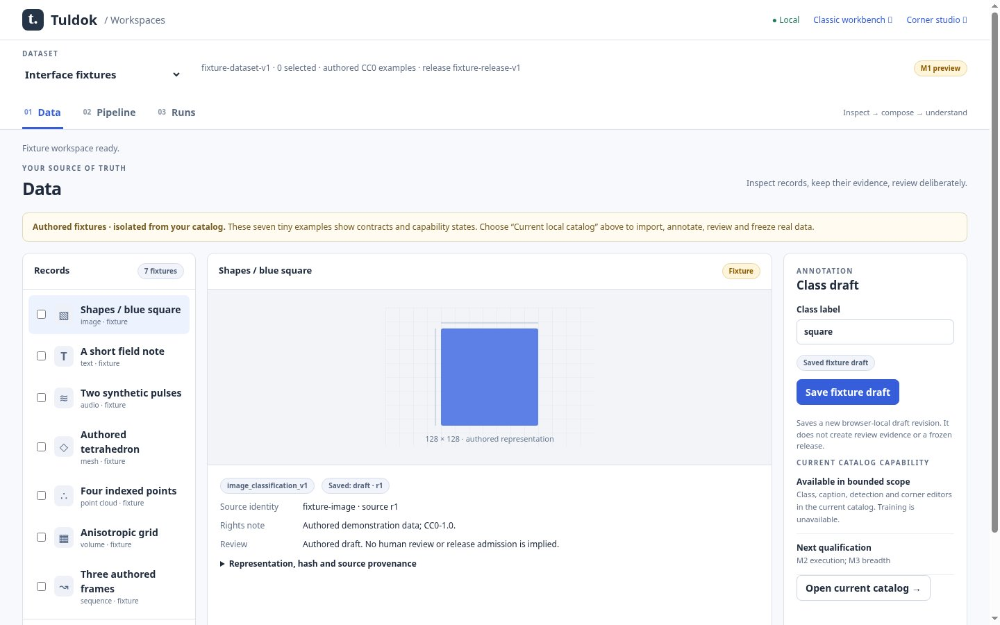
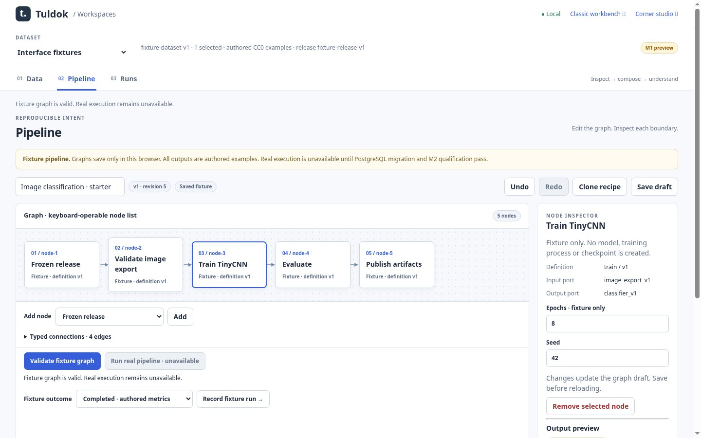
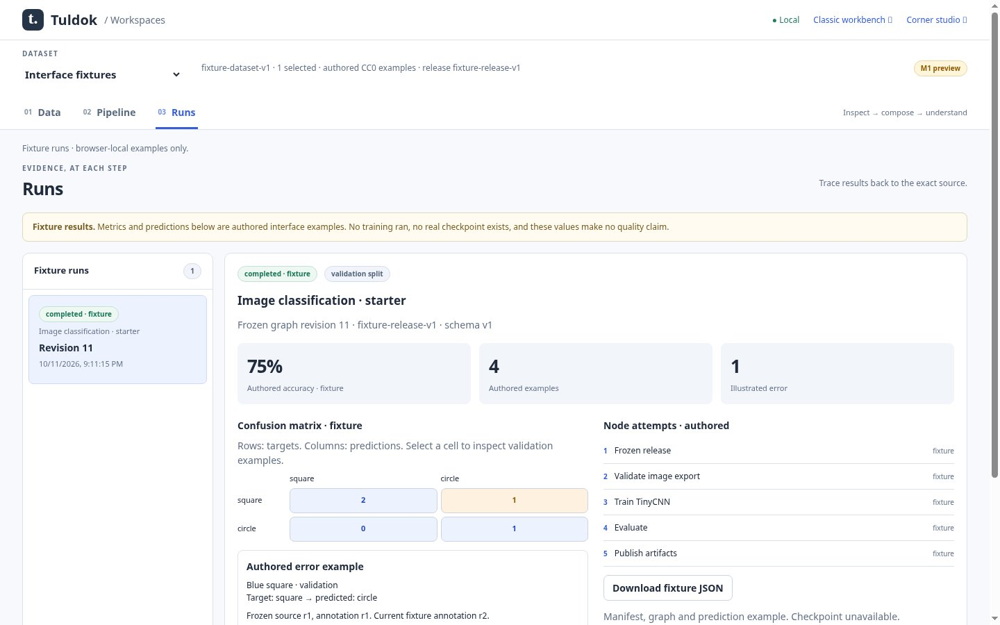

# M1 implementation evidence

## Admission and isolation

The 2026-10-11 delegated user instruction admits **M1 start** against
`docs/plans/dataset-centered-workspaces/plan.md` at approved plan commit
`4d8a237e9221d8cc327a547df1abb846460ed1a3`. This feature branch,
`ui/dataset-workspaces-m1-20261011`, starts at that plan commit; its product base
is main `1bb2c3ae9d08432c53ddf9d4bf77fa5f62ad318c`. The UI worker owns this
branch. Parent/integration owner serializes integration with the separate MB
storage worker. No main merge or deployment is authorized.

The precise write set extends M1's named static files with
`workspace-service.js`, `workspace-fixtures.json`, `workspaces-data.js` and
`workspaces-data.css`, plus a Node service contract test. These are the fixture
boundary and opt-in presentation adapter, not new backend owners. `app.py` adds
only explicit static routes. No SQL, schema, migration, real run service, model,
weights or production training changes are included.

PR33 at `581fa5ca471186ed641ec4bf6d134ee1ba807d22` was inspected. Its compact
drawer/retained-control approach informed this design; no commit or file from
that branch was merged or copied. Its failing lifecycle CI is not waived.
The opt-in bridge leaves standalone `/workbench` styling and controllers intact.

## Runnable checkpoint

```sh
python3 -m pip install -r requirements.txt
python3 -u app.py --port 8092 --data /tmp/tuldok-m1-demo
# Open http://127.0.0.1:8092/workspaces
node tests/test_workspace_service.cjs
python3 -m unittest discover -s tests -p 'test_workspace_contracts.py'
```

Data defaults to clearly labelled, authored CC0 fixtures for image, text, audio,
mesh, point cloud, volume and sequence. Choose **Current local catalog** for
existing real import/edit/review/release controls. Its same-origin editor remains
mounted when moving between workspaces. The bridge exposes a small read-only
context snapshot; existing controllers own record selection, drafts, review,
rights, requests and release admission.

Pipeline owns a disposable browser-local graph draft with bounded nodes, typed
connections, parameters, history, save/reload and stale validation. Runs are
explicitly authored scenarios. Completed metrics are not measured, checkpoints
are absent, and JSON exports identify fixture mode. Frozen predictions bind to
the original authored release. Current fixture corrections create only new
unreviewed drafts and do not modify prior runs. Real execution is unavailable
until MB/M2 qualification. This does not qualify A2, production modalities or
Pantograph integration.

## Early evidence

The initial browser walkthrough used real Chromium with the Python application,
Playwright only as an installed local capture driver, and no remote model calls.
JPEG quality 85 captures are in ignored `build/qa/workspaces/early/`:
`data-1440.jpg`, `pipeline-1440.jpg`, `runs-1440.jpg`, `data-390.jpg`.
Viewports: 1440×900 and 390×844. These represent the initial uncommitted shell,
not final acceptance. The images were manually inspected; later captures will
retain exact source revision and viewport metadata. Pipeline/Runs initial
captures revealed scroll position needing correction; viewport capture at the
top is included in the final browser gate.

Passed at this checkpoint: JS syntax, service contracts (valid/invalid modality
fixtures, malformed graph, incompatible ports, cycle, missing inputs,
unavailable ASR, bounded parameters, stale validation, immutable run snapshot,
reopen, cancel/unknown, cross-tab conflict, unsupported store version and failed
storage write), two independent Python fixture checks, and whitespace check.
This early checkpoint preceded the browser/legacy verification and independent
review recorded below.

## Standards and remaining evidence

Adopted Coding-Standards authority remains
`dcc56f26e884ade260770beceba2501d3746200d`. Local application has no `AGENTS.md`
or `.agents/skills`; the fetched standards skill is authoring-only and does not
apply. No Standards Engine MCP is available; no Engine route/certificate is
claimed. Source review routes Core/Router, Implementation, Proportionality,
Verification, Commit, Frontend, Accessibility, Contracts, Concurrency,
Persistence for disposable fixture storage, and Documentation. Plain JS/Python
and no framework build are retained. Source-based review does not claim an
engine-backed compliance result.

The branch is retained for parent review; no task-created worktree or external
dependency is removed. The completed M1 source review and CI evidence below
remain separate from full integration readiness.

## Qualification additions

The final UI uses a compact node canvas with drawn edges and an equivalent
keyboard-operable node/connection form. Changing a parameter immediately marks
the draft dirty and preview stale. Drafts may be saved while invalid; recording
an authored run requires a valid complete starter graph. Unknown definitions,
versions, malformed stored runs, conflicting tabs, and unsupported store
versions fail explicitly. The fixture store envelope is now **v2**, retaining
its original namespace so v1 checkpoint data is detected and left untouched
until an explicit demo reset. Graph and authored record contracts remain v1.

Browser history retains the selected dataset handle, fixture record/selection,
and selected run. Current catalog context is re-read and exact revisions are
checked on reload; missing or changed sources are reported instead of silently
opening a different/newer record. This is navigation memory for the current
catalog, not the persistent opaque dataset identity owned by MB. Unsaved live
edits are never replayed as saved data. Overlapping restore generations, newer
editor/selection/response intent, and failed refreshes retain current work and
release the restoration gate. Existing annotation, rights and review controls
remain their original owners and DOM elements.

The additive `.github/workflows/workspaces-m1.yml` runs fixture contracts and the
real browser gate on this branch, independently of the existing lifecycle job.
It uploads ignored screenshots/receipt for 14 days. This is a narrow write-set
extension to avoid serial editing of the storage worker's existing workflow;
it does not disable or waive any existing job. A one-off pinned Prettier 3.6.2
formatter was used from `/tmp` for readable new source. It adds no runtime/build
or checked-in package dependency.

Verified locally during implementation:

- `python3 -m unittest discover -s tests`: **417 passed** (141.758 s).
- Registered existing controller/static gate subset: **43 passed, zero failed**,
  `python3 scripts/qualify_text_classification_local.py --only 'node (tests/test_|--check)' --python python3`;
  receipt `build/qa/qualification/run-12l0po3s/gates/summary.json`.
- Existing real Chromium `browser_workbench.cjs`, `browser_meshes.cjs` and
  `browser_sequences.cjs`: **passed**, including original Data review/export,
  legacy source/revision ownership, and narrow layouts.
- `node tests/test_workspace_service.cjs` and both
  `tests/test_workspace_contracts.py` cases: **passed**.
- M1 browser walkthrough: actual pointer and keyboard activation, all seven
  representation/capability examples, retained drafts/selection, native discard
  dialog, empty Runs, parameter edits, undo/redo/clone, typed reconnect,
  unavailable audio node, graph save/reload, stale validation, all five run
  states, per-cell meaning, frozen/current correction linkage, fixture JSON
  download, current catalog import/human review, responsive tools/focus,
  revision-checked reload/conflict, failed restore refresh and subsequent
  context updates, browser Back, run selection reload, unsupported fixture
  store refusal. Fixture-only actions issued **zero API POSTs**.
- Actual upstream `plan_contract.validate_plan`: **passed** for the updated
  active/Verifying plan. No Standards Engine certification is claimed.

The full training-bearing offline aggregate is **not passed**. Its prerequisite
probe is recorded at `build/qa/qualification/run-z24othta/gates/`: the installed
consumer environment lacks pinned TRL/datasets/transformers/Torch/accelerate/
tokenizers. No installation, training or model acquisition was performed.
This affects full merge qualification, not the isolated M1 fixture workflow.
The parent must reconcile this evidence with its qualified integration
consumer environment. Hosted CI and final independent source review are
recorded separately below; local checks do not imply them.

## Reviewed source and hosted evidence

The final product/test source checkpoint is
**`f8e8ea4e7718bc139e36ffea4002f77c5187cf82`**, pushed on
`ui/dataset-workspaces-m1-20261011`. The following documentation checkpoint only
records its evidence; it does not change product or test source. The earlier
runnable checkpoint remains `9ae31492140505fc7bc6e23406c36f85034c1c08`.

- **Independent review accepted the bounded M1 scope with no open actionable
  findings** at this exact SHA. The reviewer reran service/contracts, the full
  Chromium gate and additional restoration race probes; see the
  [independent review record](independent-review.md).
- **Hosted M1 CI passed**, including contracts, real Chromium navigation and
  screenshot upload: [run 38175309323](https://github.com/MrScripty/Tuldok/actions/runs/38175309323),
  head `f8e8ea4e7718bc139e36ffea4002f77c5187cf82`.
- The [screenshot artifact](https://github.com/MrScripty/Tuldok/actions/runs/38175309323/artifacts/11715826428)
  includes source-bound receipts and captures. Its SHA-256 is
  `3536d6e83203459673fbe7d0e86eb08d966662565658d39083f683ac44e6c75c`;
  GitHub retention expires on 2026-10-25. This is hosted M1 evidence, not a
  claim that the existing full lifecycle/consumer workflow passed.

The clean local browser receipt is
`build/qa/workspaces/run-z0x61u/receipt.json`: source `f8e8ea4`, `dirty: false`,
Chrome `151.0.7922.173`, command `node tests/browser_workspaces.cjs`.
The independent rerun is `build/qa/workspaces/run-jnR4bj/receipt.json`, also
clean at that source. Each records all 18 interaction checks and no training.
The three real API writes in each full walkthrough are the explicit current
catalog import/save/review checks against an isolated temporary test catalog;
fixture-only actions were separately asserted to issue zero API POSTs.

All 15 final local JPEG85 screenshots were manually inspected by the UI owner:

| Capture group in `build/qa/workspaces/run-z0x61u/` | Dimensions | Findings |
| --- | --- | --- |
| `data-1440.jpg`, `pipeline-1440.jpg`, `runs-1440.jpg` | 1440×900 | Compact readable hierarchy, authored state labels and source context visible |
| `data-1024.jpg`, `pipeline-1024.jpg`, `runs-1024.jpg` | 1024×768 | Panels and graph adapt without overlapping controls |
| `data-390.jpg`, `pipeline-390.jpg`, `runs-390.jpg` | 390×844 | Readable narrow layout, bounded local scrolling, no whole-page horizontal overflow |
| `data-zoom200.jpg`, `pipeline-zoom200.jpg`, `runs-zoom200.jpg` | 720×450 CSS viewport | 200% equivalent reflow coverage from a 1440×900 viewport; readable wrapped controls and vertical scrolling |
| `catalog-1440.jpg`, `catalog-390.jpg` | 1440×900 / 390×844 | Original real Data controls retained in the compact adapter |
| `loading-error-390.jpg` | 390×844 | Explicit failure and keyboard-operable retry, no fake loaded state |

The zoom captures test effective CSS viewport reflow; they are **not a native
browser zoom-setting assertion or complete accessibility audit**. Native 200%
zoom and maintainer visual acceptance remain part of final integration review.
The independent reviewer also inspected desktop, tablet and narrow captures.

## Published documentation images

The delegated follow-up explicitly requested durable, directly reviewable
documentation images on the UI branch. The six curated captures below are the
narrow exception to the normal ignored-QA-output rule. The complete browser
output stays in `build/qa/`; these published images are documentation, never
test fixtures or inputs. They preserve the original JPEG85 bytes and visible
fixture labels without cropping, resizing, recompression or relabelling.

All six capture reviewed source **`f8e8ea4e7718bc139e36ffea4002f77c5187cf82`**
with a clean working tree. Desktop images are 1440×900, narrow images 390×844;
the complete set is 497,118 bytes. The
[image manifest](../../../../images/workspaces-m1/manifest.json) records exact
dimensions, hashes, source, capture command and fixture status. They show the
M1 interface before PostgreSQL integration; no training ran.

### Data



[Open desktop Data](../../../../images/workspaces-m1/data-1440.jpg) ·
[Open narrow Data](../../../../images/workspaces-m1/data-390.jpg)

### Pipeline



[Open desktop Pipeline](../../../../images/workspaces-m1/pipeline-1440.jpg) ·
[Open narrow Pipeline](../../../../images/workspaces-m1/pipeline-390.jpg)

### Runs



[Open desktop Runs](../../../../images/workspaces-m1/runs-1440.jpg) ·
[Open narrow Runs](../../../../images/workspaces-m1/runs-390.jpg)

## Handoff and boundaries

M1's runnable implementation, focused browser/contract gates, screenshots,
independent review and hosted M1 CI are delivered. A1 remains pending maintainer
acceptance; A2 and production modality/execution claims remain pending their own
milestones. The full consumer environment prerequisite is recorded as I11.

Shared integration surfaces are only additive static route entries in `app.py`,
navigation/script additions in `static/index.html` and `static/workbench.html`,
README and these plan records. Existing backend/SQL owners and the original
lifecycle workflow are untouched. Parent integration must serialize these
small overlaps with MB and any chosen PR33 work, then rerun affected gates on
the combined candidate. The separate PostgreSQL worker's branch is neither
integrated nor declared qualified by this report. Real execution remains
disabled until accepted MB/M2 evidence exists. No PR, merge or deployment was
performed.
