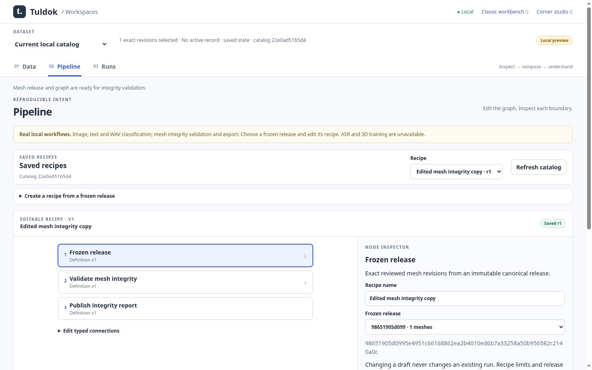
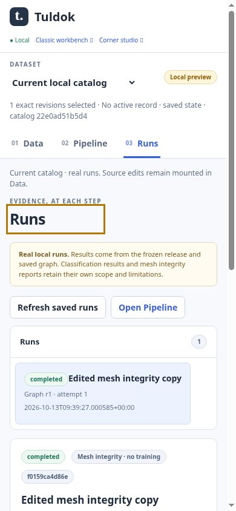

# Mesh Pipeline/Runs checkpoint — 2026-10-13

The `mesh_validate_export` recipe now connects reviewed frozen meshes to editable Pipeline and durable Runs. It uses the existing strict native reader, sole supervisor, PostgreSQL graph/run tables and local artifact custody. No training runtime is required. Selected-record-only family validation and all native-reader limitations remain explicit.

## Evidence and status

- Eight real PostgreSQL mesh-run integration tests passed, including report/download/reopen, stale graph/token/definitions, source drift, cancellation/retry/interruption, unsupported canonical records, report tamper and symlink rejection. Independent reviewer reran all eight successfully.
- Six existing Pipeline tests passed. Existing Runs checks passed except the worker's one real training case which lacked its interpreter; root's correctly configured full suite is pending at this checkpoint.
- Real Chromium flow passed after final backend changes: Data review/freeze, edited and cloned graph, actual validation completion, exact report/release downloads, no prediction/exposure requests, and application reopen. Desktop1440 and narrow390 captured; keyboard activation and overflow assertions passed.
- Source review found disk/loaded-module identity drift. The adapter now binds admission to its import-time source closure and refuses changed source until restart. The regression proves a changed source fingerprint is unavailable.
- Existing real image, text and audio browser regression gates passed with the qualified CPU interpreter. Hosted lifecycle CI and the complete Python suite remain pending. This is a runnable draft checkpoint, not whole-milestone acceptance.

Commands: `python -m unittest discover -s tests -p test_mesh_runs.py`; `python -m unittest discover -s tests -p test_pipeline.py`; `node tests/browser_workspace_mesh_run.cjs`. Local environment: Python3.12, real PostgreSQL17 Docker service on loopback, Chromium with isolated temporary profiles and the repository's headless/no-sandbox test mode; software-rendered browser evidence does not claim every desktop/GPU platform. New browser gate is registered under the existing offline network restriction in lifecycle CI.

## Captures

Original JPEG85 captures and provenance are retained in [the manifest](../../../images/workspaces-mesh-runs-20261013/manifest.json) and [browser receipt](../../../images/workspaces-mesh-runs-20261013/receipt.json). Captures use authored asymmetric-prism source geometry, not simulated production data or model outputs.

