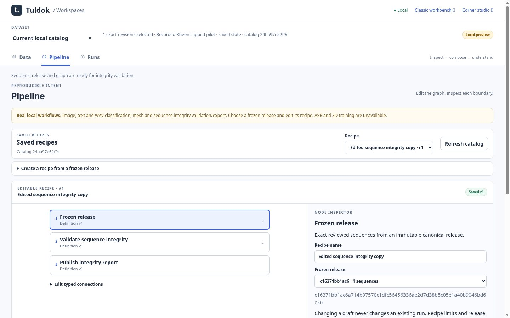

# Bounded sequence frozen-release reader admission

Canonical plan: `docs/plans/dataset-centered-workspaces/plan.md`; operation:
`continue`; lifecycle: Active. Admitted source and plan revision:
`c522bf6b5eaf94d89811578c9e73aecfdba4ef9e`. The user goal is to complete all
remaining Tuldok milestones with standards-compliant implemented code. This
supersedes historical slice-only admission restrictions, not merge/deploy gates.

Actor: sequence worker. Root is the serial integration and canonical-plan owner.
Source branch: `feature/workspace-sequence-runs-20261013`; worktree:
`/workspace/Tuldok-sequence`; target: later draft PR to main, never automatic
merge. Retain this worktree for root completion/disposition. No prerequisite for
the reader; later graph/run wiring depends on root's mesh export-recipe slice.
Check intervening canonical-plan/shared-owner changes before integration.

## Outcome and write set

Read a frozen sequence-only canonical v1 ZIP, prove archive/record/source custody
and the existing full Rheon accepted-state contract, and return bounded JSON
without changing catalog, original release, review or source files. No new
formats, simulation, training, dependencies, schema migration or UI claim.

Own `sequence_release.py`, `tests/test_sequence_release.py`,
`docs/contracts/sequence-release-validation.md` and this admission. Extract the
existing canonical envelope checks into `canonical_release.py` with narrowly
updated `mesh_release.py` to prevent two competing canonical custody contracts.
Mesh native policy/public report stay with their existing owner. Root alone owns
Pipeline/Runs/UI/CI and the canonical plan/ledger.

## Design and standards

Adopted Coding-Standards revision:
`dcc56f26e884ade260770beceba2501d3746200d`. Read Core, Router, Implementation,
Verification, Planning, Development Proportionality, Code Design, Contracts,
Documentation and Concurrent Plan Integration. No Engine certificate is claimed.
The existing plan provides the composed design; this bounded continuation keeps
Releases as producer, native Rheon reader as numerical authority and the new
reader as frozen archive consumer. Shared canonical custody is extracted only
for the two demonstrated callers; no plugin registry or new persistence owner.

The reader is necessary because a downloaded frozen archive crosses a trust
boundary after producer validation; a valid manifest alone cannot establish
its nested raw source, metadata, projection or family consistency. Existing
native verification is reused rather than copied. Exact bytes bind source and
release identity, while native numerical validation proves the bounded pilot
contract. Canonical v1 lacks omitted-ancestor evidence: report selected-family
consistency only. Remove/revise this reader when the producer format is retired
or a replacement owner supplies the same proof.

## Acceptance

- Contract / representative / automated: actual retained producer fixture passes
  the reader through a real PostgreSQL-backed review and frozen release; original
  files, native numeric bits, frame/time/unit metadata and source hashes survive.
- Focused / not-applicable / automated: malformed archives, native data, stale
  metadata, review/revision, projections and selected-family contradictions fail.
- Integration / representative / automated: validation changes no catalog/history
  or release bytes; old releases still validate after current record edits.
- Regression / representative / automated: existing mesh release tests and native
  sequence tests pass after shared custody extraction.

Root must still provide Pipeline/Runs/browser integration, independent review,
final lifecycle/CI and publication before M5c can be accepted. This admission
and reader do not mark M5c complete. No model or external producer run is claimed.

## Reader checkpoint evidence

Implemented the sequence reader and shared canonical custody owner without
modifying either native Rheon module. The mesh public report is retained; its
canonical diagnostics now identify the shared canonical owner. Local real
PostgreSQL qualification on 2026-10-13:

- `python -m unittest discover -s tests -p 'test_*release.py' -v`: 11 tests
  passed, including all six retained mesh tests and five sequence-reader tests.
- `python -m unittest discover -s tests -p test_sequences.py -v`: 13 tests
  passed, including native optimized-Python and PostgreSQL schema regressions.
- `python -m py_compile canonical_release.py mesh_release.py sequence_release.py`
  and `git diff --check`: passed.

The first focused run found a test expecting the protected-family check while
an empty group list correctly failed the earlier snapshot decoder. Changed the
negative input to a nonempty unrelated group, reaching and proving the intended
protected-family check; no runtime bypass was added. Final tests pass.

Runtime: existing app virtual environment and isolated loopback PostgreSQL.
The exact integrated source, independent review, graph/run/browser evidence and
CI remain root-owned and pending. No commit or publication performed by worker.

## Integrated graph/run checkpoint

Root fast-forwarded the complete mesh proposal904d5c0 before integration. The sequence branch targets feature/workspace-mesh-runs-20261013 as a stacked draft while PR38 awaits merge approval. This supersedes the reader-only target/base statements above. Backend worker owns pipeline.py/runs.py/release_validation.py/tests/test_sequence_runs.py and workspace sequence contract; UI worker owns workspace-real.js/browser_workspace_sequence_run.cjs; root owns plan/README/CI and publication.

The closed sequence_validate_export recipe now provides release→validate→publish through the existing graph and Runs owners, distinct adapter identity and immutable native summary. No new schema or trainer. Independent review passed 11 mesh/sequence release tests, six sequence-run tests, eight retained mesh-run tests and six Pipeline tests, and found no blocking findings. Real Chromium passed Data file import/review/freeze, graph edit/clone/invalid connections, actual completion, native field bits and exact report/release downloads, and restart persistence; retained mesh browser passed. Full Python and hosted offline lifecycle gates are pending at this draft checkpoint.

Original JPEG85 screenshots and browser provenance: [manifest](../../../images/workspaces-sequence-runs-20261013/manifest.json), [receipt](../../../images/workspaces-sequence-runs-20261013/receipt.json). Root visually inspected desktop graph and reviewer inspected narrow results. This qualifies retained nine-frame transport-pilot integrity, not a fresh simulation, general dynamics or training.

