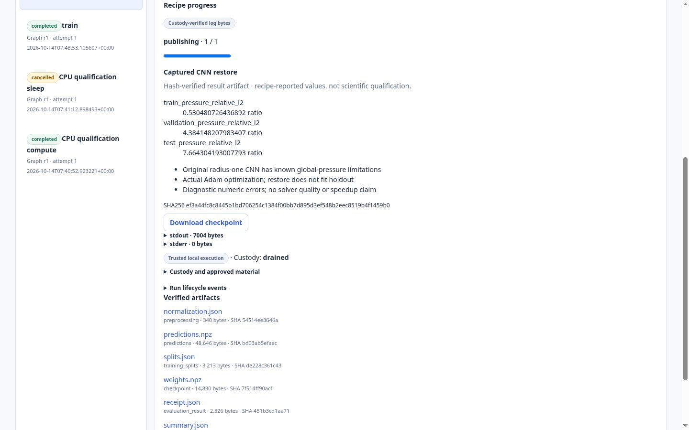
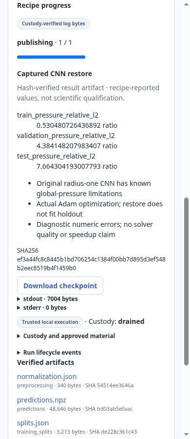

# Managed captured-data CNN qualification

Actual execution on 2026-10-14 used the published lab handoff at PR1
`2a49aa81a26efc8ccbfdc3f756b39ccd5019ff15`, clean numerical source
`d2b344fcbf2267e5851f6f1bb2371cb8ca48e58b`, and paired Tuldok CLI
`cdbe5136e05f2b49c43b9884f3ed03dcc8c7025c`. The lab source was reproduced in an
isolated ignored clone beneath Tuldok build/; neither lab source checkout was
edited. Source/data/recipe meaning remains exclusively lab-owned.

[Compact observed receipts](managed-cnn-evidence.json) retain exact grants,
Run/material/runtime/source/input/output identities, numerical receipts, complete
negative native case results and UI observations. Generated full material,
preflight, custody, runtime proofs and downloaded payloads remain in ignored
`build/qa/managed-project-runtime/cnn-managed-v2/`. No credentials are committed.

## Preparation and actual boundaries

The root lab binary was built from clean d2b344fc using pinned Rust1.92.0,
`cargo build --release --locked --jobs2` and Rheon pressure source
`34235d33c886aa05b5bdf95d920b863d1fb2ad6f`. Its original generator produced18
native verified cases; the lab packager preserved8train/4validation/4test cases
and excluded2check cases. Reproduced bytes match the published handoff:

| Input | SHA256 |
| --- | --- |
| Dataset NPZ, 87,584bytes | `38cd317657d222145b6007792ee68eb2bdf70ba92ed2735f34cb9daa6ebbd9cf` |
| Persisted whole-seed/family splits | `de228c361c43bde6bf9c1fdacb30d15e4d2864fc9242cfa9e9f5ef3f8fd82c7a` |

The existing runtime owner captured CPython3.12.14, Torch2.8.0+cpu and
NumPy2.3.5. Snapshot `9b05b82bfbe16feec4c8497547fa8adb4fa9d988135033d3413ea9c9c4668335`
contains21,110files/881,688,695bytes. [Actual source configuration](managed-runtime-config.json)
records explicit unsupported optional component exclusions, preserving required
torch_shm_manager and the original loader policy. No loader rule was relaxed.
The prior NumPy2.5.4 snapshot remains unchanged; the lab wrapper explicitly requires
2.3.5, so a separate fresh snapshot was admitted.

The lab assembler substituted this actual snapshot for its inventoried runtime.
Recipe source bytes match the published handoff exactly after accounting for that
single explicit snapshot selection: original train hash a95aae0e...da628f77,
restore hash e5693063...b5cf783d. Actual managed recipe hashes are
`2c46c3936d2ea0e735a7d42ce59c4c43213f8018487cc38b1615eb95e208d7cf`
and `33cef3f4605faa9b6c9be22ae1d0f39c75d535e032f812863b226b78957325c7`.

The new generic `tests/qualify_project_cli.py` owns no model, optimizer, reader,
physics or numerical thresholds. It selects authored stage fixtures and drives
the production CLI subprocess, authenticated HTTP, saved Pipeline, exact owner
grant, sole Runs custodian, verified downloads and service/catalog reopen. Owner
grants use the real domain approval owner with an explicitly bound local owner
session; project/graph/admission/status/artifact calls go through CLI/HTTP. No
actor, queue, completion or custody receipt is injected.

The train recipe captures only `cnn.py`, unchanged `train_cpu.py`, dataset and
splits. It has no native_sources declaration or live Rheon dependency. Native
generation is a separate preparation action; training and fresh restore operate
solely on captured bytes in their approved source/runtime closure.

## Managed results

| Stage | Run ID | Outcome |
| --- | --- | --- |
| Training | `6bf8bf9fcec141be95426576e941f886` | completed/drained, 200actual Adam updates |
| Fresh restore/evaluation | `097d69d2c6d144b9881e6baed52f8198` | completed/drained, zero optimizer updates, exact retained predictions |

Both valid custody receipts report spawn_closed, drained, ECHILD and completed
exit0. Restore binds checkpoint, splits, preprocessing, prior predictions and
receipt directly to the completed training Run's role/hash-bound artifacts.
All6outputs per stage downloaded through whole-file SHA256 verification. After
closing/reopening the catalog/service, all12outputs downloaded again and matched
their first bytes. Neither stage was replayed.

Training produced the exact published and historical CNN checkpoint:
`7f514ff90acf5adc42b009fa42c715658b4d8087ae9e4ca0e547af7f62c64121`.
Its actual normalized training MSE decreased from1.6005992247136955 to
0.058441407944808045 over200Adam updates, ratio0.03651220558054541. Normalization
and updates use only the8persisted train cases. Training reports12train/validation
predictions without loading test arrays. Fresh restore exactly reproduces those
predictions and separately evaluates the previously exposed test family.

## Negative physics result remains negative

The native lab evaluator independently consumed the restored raw predictions.
**Zero of16cases qualified**; all16failed the reference pressure/divergence
criterion. Maximum corrected float32 divergence is17.457689086596172. Restored
test mean relative pressure L2 is7.664304193007793. This reproduces the known
radius-one CNN's negative diagnostic rather than establishing solver quality.

The successful managed Run establishes real optimization, weights, split/input
custody and fresh restore. It does not establish modal trajectory parity,
acceleration, general fluid validity, GPU use or remote execution. The parent's
separate modal refit/replay reports retain zero optimizer steps and are not used
to satisfy neural acceptance.

## Existing UI and supporting checks

Actual Chromium151 viewed both CLI-created completed Runs. Checkpoint downloads,
verified metrics, drained custody and the explicit numerical limitation appear
in the unchanged Runs UI. Desktop1440 and narrow390 views had no horizontal
overflow or runtime exception. The reviewed restore captures show the large
validation/test errors and scope statement visibly:





Train captures: [desktop](cnn-train-1440.jpg), [narrow](cnn-train-390.jpg).
The ordinary7CLI tests passed again in8.933s. Compilation, whitespace and adopted
structural plan checks passed. Exact-head CI for the initial CLI commit passed;
the follow-up qualification commit requires its own final CI/independent review.

An initial qualification-driver attempt assumed project detail included the raw
manifest and failed before graph/Run creation. The driver now checks the local
fixture's exact manifest SHA256 against registered bytes before reading refs;
the corrected managed path passed. A first screenshot attempt selected an
unsupported fixture value; selecting the actual catalog value corrected the
test-only capture. Neither failure was treated as execution or UI acceptance.

## Reproduction

Install/build/package using the lab's published clean reproduction commands.
Capture its explicitly pinned runtime through Tuldok's existing quiesced owner.
Assemble with the actual captured snapshot. Create an authored stage fixture:

```json
[
  {"name":"train","recipe_id":"train","parameters":{"steps":200},
   "inputs":{"dataset":"dataset","splits":"splits"}},
  {"name":"restore","recipe_id":"restore","inputs":{
   "dataset":"dataset","splits":{"stage":"train","artifact":"splits.json"},
   "checkpoint":{"stage":"train","artifact":"weights.npz"},
   "receipt":{"stage":"train","artifact":"receipt.json"},
   "normalization":{"stage":"train","artifact":"normalization.json"},
   "predictions":{"stage":"train","artifact":"predictions.npz"}}}
]
```

With the explicit disposable PostgreSQL DSN and an existing qualification owner:

```sh
.venv-agent/bin/python tests/qualify_project_cli.py \
  --catalog build/qa/managed-project-runtime/catalog \
  --project build/qa/managed-project-runtime/lab-source/runs/cnn-project \
  --stages build/qa/managed-project-runtime/cnn-stages.json \
  --output build/qa/managed-project-runtime/new-cnn-managed
```

This is trusted qualification code that creates exact owner grants for the
explicitly selected stage fixture. Review its selected source/material and
effects deliberately; it is not a public CLI auto-approval operation.
