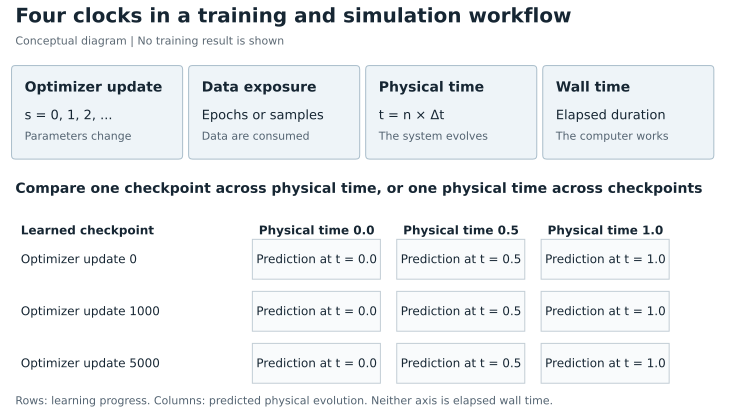
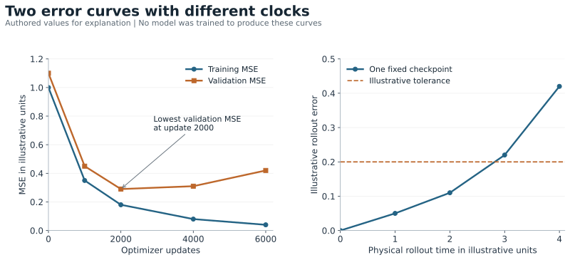
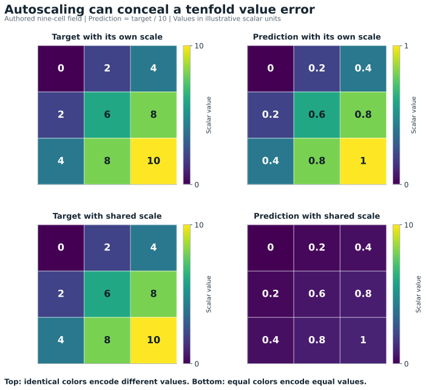

# Evaluating and Visually Understanding Model Training Runs

## A principles first research tutorial from individual predictions to scientific surrogate reliability

**Research synthesis and educational chapter**  
**Literature checked 15 October 2026**  
**Audience:** readers who can recognize an input and an output but want to become competent at interpreting training, diagnosing failure, and defending an evaluation decision.

## Abstract

A falling loss under like-for-like measurement answers a narrow question: the chosen objective improved on the measured examples. Changing minibatches, augmentation, or loss definitions can also change a logged loss. Neither a downward trace nor a fixed-set improvement establishes correct inputs, reliable unseen predictions, physically valid dynamics, calibrated uncertainty, or useful speed. This chapter develops a general framework for evaluating model training runs by connecting five kinds of evidence: data meaning, optimization health, held-out behavior, domain constraints, and application utility. The framework applies to text, images, audio, tabular data, and structured physical fields, and does not assume a particular model architecture, training library, or experiment dashboard.

The substantial worked case is a three-dimensional fluid surrogate. It explains why optimization steps and physical time must be kept separate; why one-step agreement can coexist with failed long rollouts; why velocity magnitude, pressure, conservation, and boundary behavior need different checks; and why fast inference is only one component of a useful hybrid solver. Fixed validation probes and checkpoint predictions provide the central visual method. Curves summarize a run, while aligned input, target, prediction, error, and uncertainty views reveal what those summaries hide.

The chapter also distinguishes supervised losses, evaluation metrics, human quality scores, and reinforcement-learning rewards. Human feedback can help specify ambiguous preferences, but converting a score into a learning signal requires an appropriate optimization mechanism and independent evaluation. The chapter ends with a diagnostic decision guide, staged exercises, a practical checklist, and open research questions. The bibliography identifies original research, its publication status, the claims it supports, and important limits. All numerical teaching examples and figures are authored illustrations. No training experiment, project-specific benchmark, or physical validation study is reported here.

## How to use this chapter

Read Sections 1–5 first if training is new to you. Read Sections 6–9 when you have a run to inspect. Sections 10–13 develop the physics case. Sections 14–16 explain scoring, fair experiments, and release decisions. Sections 17–19 turn the ideas into practice.

By the end, you should be able to:

1. Explain what a loss curve measures and what it cannot establish.
2. Reconstruct the exact input and target a model received, including transformations.
3. Design a split that matches the generalization claim rather than merely producing three folders.
4. Compare the same examples across checkpoints with truthful visual scales.
5. Separate optimization failures from data, metric, and rollout failures.
6. Evaluate a physical surrogate through reference agreement, constraints, uncertainty, and end-to-end cost.
7. Choose whether a quality score should remain an evaluator, become a supervised objective, or motivate preference learning or reinforcement learning.
8. Defend a conclusion with its independent evidence, budget, uncertainty, and remaining limitations.

The organizing principle is simple: **ask a precise question, identify the evidence that could answer it, and choose a representation that preserves the meaning of that evidence.** A dashboard is useful only after these decisions have been made.

## 1 A training run is a sequence of hypotheses

### 1.1 What changes during training

Think of a model as a parameterized rule. Its input is $x$, its output is $f_\theta(x)$, and its adjustable parameters are $\theta$. For a supervised task, a training example also supplies a target $y$. A loss function assigns a penalty to disagreement between the prediction and target.

A parameter is an adjustable number inside the model. A minibatch is a small group of examples used to calculate an update. A gradient collects local derivatives: information about how changing those adjustable numbers changes the objective. That information can help optimize the objective even when the objective describes the wrong task.

At optimization step $s$, a minibatch $B_s$ gives an estimate of an objective:

$$
\widehat L_{B_s}(\theta)
= \frac{1}{|B_s|}\sum_{i\in B_s}\ell(f_\theta(x_i),y_i).
$$

The simplest gradient update is:

$$
\theta_{s+1}=\theta_s-\eta_s\nabla_\theta\widehat L_{B_s}(\theta_s),
$$

where $\eta_s$ is the learning rate. The derivative indicates how a small parameter change affects the chosen loss. Backpropagation efficiently propagates this derivative through a computational graph; the classic neural-network formulation is presented by [Rumelhart, Hinton, and Williams, 1986](https://doi.org/10.1038/323533a0) [R1]. Modern optimizers may use momentum, adaptive scaling, regularization, clipping, or other state. Therefore the actual parameter update need not be proportional to the raw gradient.

Training creates a sequence $\theta_0,\theta_1,\ldots$. Each saved **checkpoint** is one hypothesis about the input–output relationship. Evaluating a run means studying this sequence and deciding which hypothesis, if any, is useful under the intended conditions.

The population question is different from the minibatch question. If deployment examples follow distribution $P$, the corresponding expected risk is:

$$
R_P(\theta)=\mathbb E_{(x,y)\sim P}[\ell(f_\theta(x),y)].
$$

The training objective is computable from available data. The deployment expectation usually is not. Held-out data estimates performance under its own sampling process; whether that estimate applies to deployment depends on the relationship between those two processes.

### 1.2 Keep the clocks separate

A physical surrogate can involve at least four different clocks.

| Clock | Meaning | Example question |
| --- | --- | --- |
| Optimizer step $s$ | Number of parameter updates | Did checkpoint 5000 improve over checkpoint 1000? |
| Epoch or exposure | Passes through, or examples/tokens sampled from, the fitting data | How much data has each model consumed? |
| Physical time $t$ or frame index $n$ | Time within a simulated or measured trajectory | Is the predicted flow correct at 2 seconds? |
| Wall time τ | Elapsed computational time | How long did training or inference actually take? |

An epoch often means one pass through a finite dataset, but streaming data, replacement sampling, and variable-length batches make that interpretation less exact. Microbatches accumulated before one optimizer update do not each count as an update. A saved simulation frame may also be separated from the next saved frame by many numerical solver substeps.

A plot called “error over steps” is therefore ambiguous. Use “validation error versus optimizer update” or “rollout error versus simulated seconds.” A checkpoint at optimizer step 5000 can be evaluated on the same physical trajectory as a checkpoint at step 1000. It has not advanced that trajectory by 4000 physical steps.

**Figure 1.** The clocks measure different processes. The matrix at the bottom separates parameter-learning progress from predicted physical evolution. It is a conceptual diagram, not a measured run.

### 1.3 Evaluation has several layers

Before discussing architecture, ask five questions in order:

1. **Meaning:** Do the input, target, coordinates, units, and masks describe the intended task?
2. **Learning:** Are parameters receiving and applying useful updates?
3. **Generalization:** Does behavior improve on independent examples from the relevant population?
4. **Domain validity:** Are necessary constraints and task-specific outcomes satisfied?
5. **Utility:** Does the complete system improve the decision or workflow at an acceptable cost?

These questions are connected but not interchangeable. A model can optimize perfectly against an incorrectly shifted target. A statistically accurate model can violate a critical boundary condition. A physically plausible model can be too slow once preprocessing and fallback are included. Evaluation becomes clearer when each layer has its own evidence.

## 2 Loss metrics and rewards have different jobs

### 2.1 The training loss

A **training loss** is the quantity the learning procedure tries to minimize. Mean squared error, for example, penalizes squared numerical discrepancies:

$$
\mathrm{MSE}=\frac{1}{N}\sum_i(\hat y_i-y_i)^2.
$$

Squaring makes a large error count more strongly than several small errors with the same total absolute magnitude. In a probabilistic classification model, negative log likelihood penalizes assigning low probability to the correct class. A multi-component objective may combine data agreement, regularization, boundary penalties, and a differential-equation residual.

Loss design is a modeling choice. It determines which distinctions the optimizer is encouraged to preserve. A loss that averages every voxel equally can emphasize the large quiet region of a volume over a small, consequential jet or boundary layer. Combining pressure in pascals and velocity in metres per second without deliberate scaling lets numerical units influence the balance.

### 2.2 The evaluation metric

An **evaluation metric** measures a property we want to know. It can coincide with the loss, but it need not. Examples include classification accuracy, worst-case error, boundary flux error, event timing, a task success rate, or a human preference rate.

Metrics need not be differentiable. You can inspect images, apply a threshold, run a solver, ask a reviewer, or compute a discrete event count after producing a prediction. The evaluator is observing behavior; it is not automatically telling the optimizer how to change millions of parameters.

Consider a true velocity $u=(1,0,0)$ and prediction $\hat u=(-1,0,0)$. Both have speed one. A speed-only metric reports zero speed error, while vector error is $\|\hat u-u\|_2=2$. A beautiful speed rendering cannot reveal the reversed direction without another view. This is an authored arithmetic example of a metric blind spot.

### 2.3 The reward

A **reward** is a signal used to favor actions or outputs, commonly by maximizing an expected return. In sequential decision making, the return may combine rewards over time. A human quality rating is merely a rating until a learning procedure actually uses it in an objective or reward mechanism.

Changing the sign of a loss creates a scalar with the opposite preference, but does not by itself create a reinforcement-learning problem. If reference fields and a differentiable numerical objective already exist, supervised fitting may be the simplest suitable method. If a policy selects actions whose later consequences matter, reinforcement learning may be appropriate. If the desired behavior is best expressed by comparisons, preference learning can help specify it.

### 2.4 What differentiability does and does not require

Gradient-based supervised learning needs a way to differentiate the training objective with respect to model parameters, or use a suitable generalized derivative at isolated nonsmooth points. Absolute error is nonsmooth at zero but can still be optimized with subgradient conventions. A differentiable physics residual can contribute a direct gradient. A discrete expert rating usually cannot.

There are other mechanisms. A stochastic policy can be optimized with a score-function estimator:

$$
\nabla_\theta\mathbb E_{a\sim\pi_\theta}[r(a)]
=\mathbb E[r(a)\nabla_\theta\log\pi_\theta(a)],
$$

under the conditions permitting this identity. Here the policy probability is differentiated; the external reward need not be. [Williams, 1992](https://link.springer.com/article/10.1007/BF00992696) [R2] develops REINFORCE-style learning for stochastic units. Such estimators can have high variance and need repeated samples. This equation is not an instruction to backpropagate through a human or a black-box simulator.

For a deterministic continuous-field regressor, adding a “looks good” button does not automatically provide a usable policy distribution, credit assignment, or update rule. Decide what the score means and how it enters learning before building the interface.

## 3 Begin with the exact input and target

### 3.1 A successful file load is a weak correctness test

Inspect what the model actually receives after decoding, filtering, interpolation, cropping, augmentation, normalization, and batching. A source-file preview is not enough. The training pipeline may change the content after that preview.

For every inspected example, reconstruct:

- Original source and example identity
- Input content and target content
- Their coordinate, time, or token alignment
- Transformations and parameters applied to each
- Masked and unmasked regions
- Intended output interpretation

For text, inspect tokenization, context truncation, role markers, and which tokens incur loss. For images, overlay labels on the transformed pixels. For audio, listen to the actual segment and check transcript timing and sample rate. For tables, inspect missing-value handling, feature names, target definitions, and forbidden future information. For physical fields, inspect coordinate order, units, domain geometry, timestep, boundary labels, and whether quantities are stored at cells, faces, or vertices.

### 3.2 A three-dimensional field needs a meaning contract

An array shaped $D\times H\times W\times C$ does not reveal what those dimensions mean. Record whether the axes correspond to (z,y,x), whether one increases downward, and which channel is (u_x,u_y,u_z), pressure, density, or another quantity. A handedness change can reverse orientation. A face-centered velocity component is not interchangeable with a cell-centered value without an explicitly defined transformation.

The contract should specify:

| Item | Why it matters |
| --- | --- |
| Geometry and coordinate map | A number belongs to a location, not just an array index |
| Channel order and units | A component swap or unit change can preserve plausible-looking values |
| Physical sampling interval | A next-frame target depends on the actual time interval |
| Boundary and obstacle masks | Invalid cells and prescribed boundaries require different treatment |
| Target type | State, increment, derivative, and correction imply different reconstruction rules |
| Conditioning information | Parameters, forcing, geometry, and boundary data may be necessary to identify the answer |
| Reference provenance | Solver, mesh, tolerances, initial conditions, and revisions define the label source |

Suppose the model predicts an increment $\Delta u$, but the viewer displays it as the next state. The network can be doing precisely what it was trained to do while the animation appears broken. Conversely, a viewer that adds the input state to a model trained to predict the full next state can produce exaggerated motion. Decode the output contract before judging its appearance.

### 3.3 Normalization is part of the model

For a channel with training-set mean μ and scale σ, a common transform is $z=(y-\mu)/\sigma$. Predictions in $z$-space must be mapped back using the same fitted values. Estimate learned preprocessing statistics using the training split, then apply that frozen transformation to validation and test data. A prespecified physical nondimensionalization is different from estimating data-dependent statistics; document which you use.

Check a round trip: original value → normalized value → reconstructed value. Check units and constant channels, near-zero scales, outliers, missing regions, and numerical precision. Applying independent per-frame normalization can remove an amplitude that the task requires predicting. Per-trajectory normalization may also require statistics unavailable at deployment if it uses future frames.

An apparently excellent normalized loss can hide a poor physical error if an inverse transformation is wrong. Report physical-unit errors beside normalized scores. When transformations are nonlinear, transform uncertainty distributions or samples appropriately; a transformed variance is not generally obtained by applying the inverse transform to a standard deviation.

### 3.4 Reference correctness and model correctness are separate

A simulator provides a reference solution for its mathematical model and numerical settings. It does not automatically provide physical truth. **Verification** concerns whether the equations are implemented and solved appropriately. **Physical validation** concerns agreement with relevant observations for the intended use. [Oberkampf and Trucano, 2002](https://doi.org/10.1016/S0376-0421(02)00005-2) [R3] distinguish these activities in computational fluid dynamics.

Use analytic or manufactured cases, resolution and timestep studies, conservation checks, and solver diagnostics to investigate reference quality. Use appropriately designed observational comparisons for physical validation. Agreement with a numerical reference establishes emulation quality relative to that reference; it does not eliminate its model discrepancy or discretization uncertainty.

## 4 Splits must protect the unit of independence

### 4.1 Train validation and test are roles

The **training set** supplies fitting examples. The **validation set** informs choices such as checkpoint, architecture, loss weights, and thresholds. The **test set** estimates performance of the frozen selected procedure without influencing those choices.

These are roles in an experiment, not properties created by directory names. If test failures guide a repair, those failures become development evidence. The repaired system needs fresh independent evidence for a new final evaluation claim. Repeatedly selecting against a finite evaluation sample can overfit the selection criterion; [Cawley and Talbot, 2010](https://www.jmlr.org/papers/v11/cawley10a.html) [R4] analyze this source of selection bias.

### 4.2 Why randomly splitting frames can mislead

Frames from the same trajectory share initial conditions, geometry, forcing, numerical artifacts, and adjacent states. If the input window for one example overlaps another example’s target, the dependence can be especially direct. A frame-level split may test interpolation within familiar trajectories while being described as performance on new simulations.

First assign the protected group to a split, then construct windows within that split. The right group can be larger than a run ID: trajectories derived from the same base initial condition, geometry, experimental subject, or source realization may belong to one family. What must be protected depends on the claim.

For a new-trajectory claim, hold out independent trajectories. For a new-geometry claim, hold out geometry families. For a future-time claim, use a causal temporal design with windows and any needed separation chosen to avoid overlap. A temporal holdout from a known trajectory answers a useful but narrower question than transfer to independent initial conditions.

The leakage taxonomy of [Kapoor and Narayanan, 2023](https://doi.org/10.1016/j.patter.2023.100804) [R5] motivates auditing the full pipeline, including preprocessing and evaluation design. Their findings about machine-learning-based science do not prescribe one universal split for every physical system.

### 4.3 Distinguish interpolation from regime transfer

Separate ordinary held-out performance from changes in viscosity, forcing, geometry, resolution, timestep, boundary type, sensor, language, or noise. An unfamiliar trajectory at familiar parameter settings is not the same challenge as an unfamiliar physical regime.

[WILDS](https://proceedings.mlr.press/v139/koh21a.html) [R6] demonstrates real distribution shifts across several application domains. Its relevance here is methodological: identify the condition that changed and measure its consequences. It does not supply evidence for a particular fluid surrogate.

### 4.4 Uncertainty in a score has multiple sources

Repeated training seeds describe variation from fitting randomness. Resampling independent evaluation families describes variation from the evaluation sample. Neither automatically measures the other. Thousands of correlated cells or frames can give an impressive sample count while providing only a small number of independent scenarios.

Compare candidate and baseline on the same evaluation families. Keep their paired per-family differences. If using a bootstrap or another interval method, resample at a defensible independence unit and state the assumptions. With very few groups, precise intervals may be difficult to defend. Report the group count and the limitation rather than treating every voxel as an independent trial.

## 5 Inspect the same examples across checkpoints

### 5.1 Build a fixed probe set

A **probe** is a chosen input whose prediction you inspect repeatedly. A fixed probe set makes training progress visible because the example does not change when the checkpoint changes.

Use three complementary collections:

1. A frozen, reproducibly sampled set of ordinary validation families
2. Declared consequential slices, including rare conditions and important boundaries
3. Development regression cases discovered during investigation

Label their roles. A case discovered because it failed is excellent for regression testing, but its failure frequency does not estimate deployment prevalence. These probe sets are development tools, not substitutes for a final test.

Do not show only the easiest cases. Preserve a reproducible sampling rule, and inspect random successes as well as failures. A correct answer may rely on a shortcut that disappears under a regime change.

### 5.2 What to preserve at each evaluation point

For a checkpoint, save enough to associate every displayed output with:

- Run, checkpoint, optimizer step, and exposure
- Probe identity and split/family identity
- Exact preprocessing and reconstruction recipe
- Model mode and inference configuration
- Prediction, reference, valid-domain mask, and metrics
- Random seed or stochastic sampling information
- Units and visualization settings

A checkpoint should be paired with its architecture and preprocessing state. A reproducible training continuation may additionally require optimizer, scheduler, random-generator, and data-order state. Evaluation generally needs less than resuming training, but more than an anonymous tensor of weights.

### 5.3 The comparison grid

For a field prediction, display input, target, prediction, signed error, absolute error, and uncertainty where available. Across checkpoints, keep the case, physical time, plane, camera, color scale, and units fixed. A row can represent optimizer progress; a column can represent physical rollout time.

This gives two different comparisons:

- Moving down a column asks whether a later learned model improved a fixed physical prediction.
- Moving across a row asks whether one learned model remains useful farther into a rollout.

For generative outputs, fixed sampling seeds can make a paired illustration easier to read, but also report variability across additional samples. One seed can hide unstable behavior. For autoregressive systems, clearly distinguish reference-conditioned next-step evaluation from free-running generation.

**Can you view the output at every training step?** Yes, if the cost is acceptable, but define which output you are viewing. The predictions used to calculate a minibatch loss are commonly computed before that step's parameter update, on an input batch that changes at the next step. To compare the learned model after each update, evaluate the frozen probes using the post-update checkpoint. Log cheap scalar diagnostics every update; save larger fields, renderings, and expensive rollouts at a cadence chosen for the question and compute budget. Viewing every update is optional, not a condition for valid evaluation.

Inference mode and gradient recording are separate concerns. Disable gradient tracking when evaluation does not need derivatives, and use the appropriate inference behavior for dropout and normalization. If residual computation needs input derivatives, preserve that capability without allowing the evaluation to mutate fitted state. Evaluation should not inadvertently update normalization buffers, and subsequent fitting should resume with its intended training behavior.

### 5.4 Example-level histories reveal hidden changes

An average can improve while a particular family regresses. Track representative per-example errors across checkpoints and connect them to inspected outputs. For classification, target probability and its variation across training can help characterize learning behavior. [Dataset Cartography](https://aclanthology.org/2020.emnlp-main.746/) [R7] develops such model-dependent maps in NLP.

For regression, analogous summaries might use per-example residual magnitude, bias, or trajectory-level error across checkpoints. This is an adaptation of the diagnostic idea, not a direct claim that the original NLP method establishes a physics label-quality test. Persistent high error can reflect a bad target, missing conditioning, a hard valid example, an unrepresented regime, or optimization failure. A score nominates inspection; it does not decide which explanation is true.

## 6 Choose metrics according to the failure you care about

### 6.1 One number cannot express every requirement

A useful metric set includes an overall measure, important slices, tails or failures, domain checks, and application outcomes. Avoid turning all of these into a weighted scalar until you can explain the tradeoffs implied by its weights.

| Output type | Useful starting evidence | Important blind spot |
| --- | --- | --- |
| Classification | Confusion matrix, per-class precision/recall, probability scores, calibration | Accuracy can hide rare-class failure and overconfidence |
| Numerical regression | Physical-unit MAE/RMSE, bias, quantiles, tolerance exceedance | Means can hide tails and systematic local errors |
| Images | Pixel error, structural/perceptual measures, task outcomes, inspected samples | Visual realism does not imply reference fidelity or factual correctness |
| Text | Task success, error taxonomy, reference metrics where appropriate, human review | Surface similarity does not establish factual accuracy |
| Audio | Signal and timing checks, transcription/event errors, listening evaluation | Aggregate scores can hide short artifacts or misalignment |
| Structured fields | Weighted field errors, component errors, boundary/constraint errors, rollout and observables | A plausible rendering can conceal wrong dynamics |

SSIM explicitly measures structural image similarity [Wang et al., 2004](https://www.colorado.edu/lab/live/publications/zwang_ssim_ieeeip2004.pdf) [R8]. LPIPS uses deep representations to assess perceptual similarity against human judgments [Zhang et al., 2018](https://openaccess.thecvf.com/content_cvpr_2018/html/Zhang_The_Unreasonable_Effectiveness_CVPR_2018_paper.html) [R9]. BLEU was developed for reference-based machine translation evaluation [Papineni et al., 2002](https://aclanthology.org/P02-1040/) [R10]. These measures answer specific questions. Applying a natural-image perceptual metric to a colored fluid slice does not make it a test of the governing equations.

### 6.2 Understand normalization and aggregation

For a field, define a weighted mean $\langle q\rangle_w=\sum_iw_iq_i/\sum_iw_i$. Cell volume may be the correct weight on a nonuniform mesh when measuring domain-integrated accuracy. Node count is not automatically equivalent to physical volume. State how masked cells, boundaries, channels, trajectories, and timesteps enter the denominator.

A physical-unit RMSE is:

$$
E_{\rm rms}=\sqrt{\langle(\hat y-y)^2\rangle_w}.
$$

A relative score might divide this by $\sqrt{\langle y^2\rangle_w}+\epsilon$. A variance-scaled score divides by a centered target scale such as $\sqrt{\langle(y-\bar y)^2\rangle_w}+\epsilon$. The precise placement and units of ε must be stated; several conventions exist. Near-zero denominators need explicit handling and an accompanying absolute score.

For an authored example with target values 99 and 101 and a constant prediction of 100, RMSE is one. Relative RMS normalization is about one percent because the mean level is near 100. A centered scale is one, so the variance-scaled error is one: the prediction missed all spatial variation. The two scores are not contradictory; they use different meanings of scale.

[The Well](https://proceedings.neurips.cc/paper_files/paper/2024/hash/4f9a5acd91ac76569f2fe291b1f4772b-Abstract-Datasets_and_Benchmarks_Track.html) [R11] reports variance-scaled errors and separately examines fields and rollout frequency bands. Its target spatial-mean comparator is a diagnostic reference calculated from the target, not automatically a deployable baseline that knows that mean in advance.

Average per-trajectory metrics and metrics pooled over all frames need not agree. Longer trajectories or larger meshes dominate a pooled average. Likewise, the square root of the mean squared error is not the mean of per-example square roots. Choose the aggregation that matches the stated population and retain constituent values.

### 6.3 Baselines give a score meaning

Compare against a predictor whose limitations are understandable: persistence for the next physical state, a training-set mean, a linear model, a reduced-order model, a coarse solver, or a suitable existing method. Persistence can be surprisingly strong at a small timestep because adjacent states are similar. Beating it on a one-step metric is useful evidence, but a small improvement does not establish long-horizon skill.

If a diagnostic comparator uses target information, label that explicitly. An oracle target mean is helpful for understanding spatial structure but is not a fair deployed competitor unless that information is available to every method.

## 7 Read learning curves as evidence rather than verdicts

### 7.1 Compare like with like

A training-loss curve often comes from changing minibatches, with augmentation, dropout, and training-time normalization behavior. A validation curve often uses a fixed set in inference mode without augmentation. Regularization may be included in one curve and excluded from the other. The numerical gap is then partly a measurement difference.

For a cleaner comparison, periodically evaluate a fixed training subset and the validation set with the same inference recipe and metric definition. Keep the online minibatch objective as an optimizer trace, but label it separately.

Plot at least the learning rate, fitting objective components, validation metric, and the exposure or wall-time axis appropriate to the comparison. Include uncertainty across evaluation families or seeds where the data support it. When changing data composition or loss weights, mark the intervention rather than pretending the curve measures one unchanged process.

### 7.2 Common shapes and alternative explanations

- **Training improves and validation worsens:** possible overfitting, selection noise, an unrepresentative split, or a changing inference configuration.
- **Both remain poor:** possible missing information, incorrect targets, insufficient optimization, restrictive architecture, or a miscomputed metric.
- **Large oscillations or sudden spikes:** possible learning-rate instability, unusual batches, numerical overflow, shifting data, or legitimate rare examples.
- **Both look excellent from the beginning:** possible an easy task, a strong initialization, leakage, a target accidentally supplied as input, or a broken evaluator.
- **Validation is better than training:** possible augmentation or dropout differences, regularization accounting, harder training cases, or different sampling. It is not automatically an error.

These are hypotheses. Determine which is supported by inspecting the exact measurement and intermediate artifacts.

### 7.3 A worked checkpoint decision

The following score sheet is authored solely for teaching. It describes no trained model.

| Optimizer update | Training MSE | Validation MSE | Validation boundary error | Rollout tolerance failures among 20 families |
| --- | ---: | ---: | ---: | ---: |
| 0 | 1.00 | 1.10 | 0.70 | 19 |
| 1000 | 0.35 | 0.45 | 0.40 | 11 |
| 2000 | 0.18 | 0.29 | 0.22 | 6 |
| 4000 | 0.08 | 0.31 | 0.12 | 3 |
| 6000 | 0.04 | 0.42 | 0.10 | 5 |

If the declared criterion is validation MSE, checkpoint 2000 is selected. If the application first requires no more than three rollout failures on this development set and then minimizes boundary error, checkpoint 4000 is the candidate. Checkpoint 6000 has the best fitting loss but fails that development requirement. The criterion must be declared rather than chosen after noticing the preferred row.

The table does not establish a population failure rate, the best eventual checkpoint, or the cause of the deterioration. It illustrates why the selected model may differ depending on the intended outcome.

**Figure 2.** Left: the authored MSE values above. Right: a separate authored rollout-error illustration. The axes represent different clocks, and none of these curves is an experimental result.

Early stopping uses validation behavior to choose when fitting should stop; [Prechelt, 1998](https://page.mi.fu-berlin.de/prechelt/Biblio/stop_tricks1997.pdf) [R12] studies the problem of choosing a stopping rule. Do not treat a textbook U-shaped curve as a law. [Nakkiran et al.](https://arxiv.org/abs/1912.02292) [R13] report settings with epoch-wise double descent. That finding cautions against universal curve stories; it does not justify unlimited training whenever validation worsens.

### 7.4 Smoothing can hide the event you need

Show raw points or an accessible raw trace alongside a smoothed trend. State the smoothing window and use comparable windows between runs. Do not interpolate missing evaluations as if they were measurements. Distinguish missing, invalid, and infinite values from zeros. A logarithmic axis makes multiplicative changes visible but requires clear handling of zero and negative quantities.

## 8 Diagnose the optimization process

### 8.1 Is the model receiving a usable signal

Inspect gradients by layer or parameter group: norms, unusually large values, persistent zeros, nonfinite values, and changes over training. Pair these with parameter norms and actual update norms. A simple diagnostic ratio is:

$$
\rho_s=\frac{\|\theta_{s+1}-\theta_s\|}{\|\theta_s\|+\epsilon}.
$$

It measures relative parameter movement, not correctness. No universal value guarantees healthy learning. Different parameterizations and near-zero parameter groups make cross-model comparisons difficult. With adaptive optimizers, momentum, or weight decay, the update trace supplies information the raw gradient alone omits.

For gradient accumulation, distinguish microbatch gradients from the accumulated gradient used in an update. For mixed precision, record loss-scaling behavior and skipped updates where relevant. Log whether clipping occurred and, if diagnosing explosions, preserve a pre-clipping norm as well as the value applied to the optimizer. Clipping can prevent a catastrophic update while concealing the frequency of the underlying problem.

### 8.2 Gradients and activations help localize failure

Activations are the intermediate values computed by the network. Inspect their ranges, means, spread, nonfinite rates, and saturation or inactivity appropriate to the activation function. A layer whose output is almost constant may remove distinctions the task needs. A deep chain with tiny gradients can learn slowly; large propagated gradients can destabilize updates.

[Glorot and Bengio, 2010](https://proceedings.mlr.press/v9/glorot10a.html) [R14] examine activation and gradient behavior in deep feedforward networks and motivate initialization choices. [Pascanu, Mikolov, and Bengio, 2013](https://proceedings.mlr.press/v28/pascanu13.html) [R15] analyze vanishing and exploding gradients in recurrent networks and propose norm clipping. These findings explain useful diagnostics, but an unusual histogram alone does not establish the cause of a failure in another architecture.

### 8.3 Compound objectives can compete

Suppose a physics loss is $L=\lambda_dL_d+\lambda_rL_r+\lambda_bL_b$, combining data, equation residual, and boundaries. Logging only $L$ can conceal that one component improved while another deteriorated. Log the unweighted components, weights, and weighted contributions.

When needed, inspect component gradients. A small scalar term can still have a large gradient; large loss values and large influence on the update are different quantities. Gradients can also point in conflicting directions. [Wang, Teng, and Perdikaris, 2021](https://doi.org/10.1137/20M1318043) [R16] investigate gradient-flow pathologies in physics-informed neural networks with composite objectives. Loss rescaling and balancing should be treated as interventions whose effects must be measured, not as automatically beneficial fixes.

### 8.4 A small-subset fit is a diagnostic test

Try fitting a small, clean, representative subset when the larger run fails to learn, using an appropriate low-regularization diagnostic configuration. If it cannot fit examples the architecture should plausibly express, investigate data alignment, gradients, optimizer wiring, reconstruction, and objective calculations before expanding the experiment.

Success establishes that one restricted fitting path works. It does not establish generalization or correctness of every branch of the production pipeline. Failure also does not prove a coding bug: noise, ambiguity, incompatible constraints, optimization difficulty, or limited expressivity may be real.

## 9 Design visualizations that preserve comparison

### 9.1 Equal colors must mean equal quantities

Use the same limits, units, color map, camera, clipping, and spatial frame for compared predictions. Show the legend. Autoscaling each panel can make a tenfold amplitude error look like a perfect match.

**Figure 3.** An authored nine-cell scalar target ranges from 0 to 10; a prediction is exactly one tenth as large. Separate panel autoscaling makes their patterns look identical. A shared scale reveals the error. Cell values are printed so that the visual comparison can be checked numerically.

A signed error field, $e=\hat y-y$, shows overprediction and underprediction. Use a diverging scale centered on zero when sign matters. An absolute-error field shows size without cancellation; a sequential scale is appropriate. When values are clipped for readability, identify the clipping and report the clipped fraction or out-of-range values.

[Cleveland and McGill, 1984](https://faculty.washington.edu/aragon/classes/hcde511/s12/readings/cleveland84.pdf) [R17] experimentally examine perceptual accuracy of graphical encodings. Their work supports choosing representations deliberately rather than equating visual appeal with quantitative readability. [Borland and Taylor, 2007](https://doi.org/10.1109/MCG.2007.323435) [R18] explain how rainbow color maps can introduce misleading boundaries and uneven perceptual emphasis. Color is useful for location and structure, while aligned positions and numerical summaries are often better for precise magnitude comparisons.

### 9.2 A three-dimensional rendering is only one view

Opaque surfaces can conceal interior failure. Transparent volume rendering can also obscure small features through depth blending. Use a coordinated collection:

- Orthogonal slices at fixed physical positions
- Selected scientifically meaningful planes
- Component maps as well as vector magnitude
- Sparse arrows or streamlines with a fixed seeding policy
- Profiles across a boundary layer, shock, interface, or wake
- Integrated observables over time
- Error and uncertainty views aligned with the state views

Always show geometry, coordinates, scale, physical time, checkpoint, and valid-domain masks. Streamlines depend on the vector field and the integration/seeding procedure; an attractive streamline image is not a direct measurement of every cell’s accuracy. Animated camera motion should not substitute for a fixed quantitative comparison.

### 9.3 Visual interpretation is not a causal explanation

Embedding maps and attention or saliency displays can suggest hypotheses. Their appearance does not, by itself, explain how a model made a decision. [Adebayo et al., 2018](https://papers.nips.cc/paper/2018/hash/294a8ed24b1ad22ec2e7efea049b8737-Abstract.html) [R19] show that some saliency methods can fail model- or data-randomization checks. Passing such a check is a useful necessary diagnostic for certain uses, not a certificate of causal faithfulness.

Loss-landscape plots are likewise projections of a high-dimensional function. [Li et al., 2018](https://proceedings.neurips.cc/paper/2018/hash/a41b3bb3e6b050b6c9067c67f663b915-Abstract.html) [R20] introduce filter-normalized visualization. [Dinh et al., 2017](https://proceedings.mlr.press/v70/dinh17b.html) [R21] demonstrate that parameter transformations can change apparent sharpness without changing the predictor. A two-dimensional surface is a diagnostic construction, not proof that a model generalizes.

## 10 A worked case in three dimensional fluid surrogates

### 10.1 Define the task before choosing the viewer

A fluid model might predict the next velocity field, a pressure field, a pressure correction, a numerical flux, a closure term, or an initial guess for a native solver. These are different tasks. Ask which quantities are predicted, which are prescribed, and which are recomputed by the surrounding numerical method.

Three important model arrangements are:

1. **State surrogate:** directly predicts a future state or its increment.
2. **Learned numerical component:** supplies a quantity inside a numerical solver, such as a flux or interpolation rule.
3. **Solver assistant:** supplies an initial guess or correction, after which the native solver continues to its stopping criterion.

[Graph Network-based Simulators](https://proceedings.mlr.press/v119/sanchez-gonzalez20a.html) [R22], [MeshGraphNets](https://arxiv.org/abs/2010.03409) [R23], and the [Fourier Neural Operator](https://arxiv.org/abs/2010.08895) [R24] illustrate different representations for learned simulation. Their existence does not settle which representation suits a particular task. [Kochkov et al., 2021](https://doi.org/10.1073/pnas.2101784118) [R25] demonstrate a learned component in two-dimensional CFD. Their reported accuracy and speedups are results for that setup, not promises for a three-dimensional pressure predictor.

### 10.2 A real example of what a falling loss establishes

A [pinned managed CNN qualification report dated 14 October 2026](https://github.com/MrScripty/Tuldok/blob/f7543fb78f6f1cb52e45dd315efa17a4b2fe6fa6/docs/plans/generic-neural-execution/reports/managed-cnn.md) [P1] records 200 Adam updates on eight persisted training cases. It reports normalized training MSE decreasing from approximately 1.600599 to 0.0584414. Separately, its native evaluator reports that none of 16 restored raw-prediction cases qualified under the reference pressure/divergence criterion.

The report also distinguishes successful execution and fresh restoration from numerical qualification. Its test family had previously been exposed. Thus it is useful evidence that fitting and restoration occurred and that this diagnostic remained negative; it does not constitute a fresh independent generalization test or establish acceleration. This chapter has read that report, not rerun the experiment or audited all underlying payloads. The older solver warm-start arrangement is not attributed to this CNN result.

The lesson is general. Falling fitting error establishes improvement on that objective under that fitting measurement. To answer “does the model produce a usable pressure solution?”, inspect the raw output, apply the declared reconstruction, evaluate the native residual and corrected velocity, and retain the resulting failures. Better execution evidence cannot replace missing numerical evidence.

### 10.3 A simple exact flow makes several checks understandable

Consider a deliberately simple, nondimensional, constant-density incompressible flow on a three-dimensional periodic domain. Let density be one, viscosity any fixed nonnegative value, pressure zero, body acceleration $f=(1,0,0)$, and initial velocity $u(0)=(1,0,0)$. The spatially uniform solution is:

$$
u(t,x,y,z)=(1+t,0,0),\qquad p=0.
$$

For the momentum equation

$$
\partial_tu+(u\cdot\nabla)u=-\nabla p+\nu\nabla^2u+f,
\qquad\nabla\cdot u=0,
$$

the spatial derivatives are zero and $\partial_tu=(1,0,0)=f$. This is an authored analytical teaching case under the stated assumptions, not a realistic turbulence experiment.

It reveals four useful facts:

- A persistence predictor incurs an $x$-velocity error of Δt after one step.
- Under repeated persistence from the initial state, its error at physical time (n\Delta t) is (n\Delta t), despite zero divergence at every step.
- The true kinetic energy increases because the forcing supplies energy. Requiring constant energy would penalize the correct solution.
- A renderer that rescales arrow length separately at every frame could make the accelerating true flow look stationary.

This is why one-step error, divergence, energy balance, and visualization scale answer different questions. A model can pass one check while failing another.

## 11 Pressure predictions need operator aware evaluation

### 11.1 Pressure values and pressure effects

In incompressible flow, pressure helps enforce a divergence constraint through its spatial gradient. Projection methods are a classical numerical realization; [Chorin, 1968](https://math.berkeley.edu/~chorin/chorin68.pdf) [R26] develops a finite-difference method using pressure and velocity in two and three dimensions.

Pressure is a scalar: one value at a location. Velocity is a vector: values for directional components. A gradient describes how a scalar changes over neighboring locations, including direction. Divergence measures local net outflow of a vector field. An equation residual measures how far the proposed values fail to satisfy the chosen equation. These definitions explain why a pressure picture, a pressure-gradient picture, and a divergence picture need not show the same errors.

For a simplified constant-density discrete projection, let $u^*$ be the provisional velocity, $G$ the discrete pressure-gradient operator, and $D$ the matching divergence operator. One convention is:

$$
u^+=u^*-\frac{\Delta t}{\rho}Gp,
\qquad A=DG,\qquad b=\frac{\rho}{\Delta t}Du^*.
$$

Then the pressure equation is $Ap=b$. For prediction $\hat p$, define the algebraic residual $r=b-A\hat p$. Substitution gives:

$$
Du^+=\frac{\Delta t}{\rho}r.
$$

This relationship is an elementary consequence of the displayed assumptions. Many implementations use the opposite sign for both $A$ and $b$, a pressure increment rather than absolute pressure, variable density, boundary lifting, or a different projection. Match the actual native operators and conventions. Computing a convenient continuum Laplacian on a plotted cell-centered field is not necessarily evaluating the solver’s discrete equation.

The example explains why pressure MSE and corrected divergence can disagree. Small pressure value errors can have consequential spatial derivatives. Conversely, a harmless constant pressure offset may increase value error while leaving the gradient unchanged when the problem genuinely allows that freedom.

Here is a numerical-scale example you can verify without training. On an even periodic one-dimensional uniform grid, let the correct pressure be zero and the prediction be $\hat p_i=\epsilon(-1)^i$ with $\epsilon\ge0$. With the standard second-difference stencil $L_h p_i=(p_{i-1}-2p_i+p_{i+1})/h^2$, pressure MSE is $\epsilon^2$, while $L_h\hat p_i=-4\epsilon(-1)^i/h^2$. The residual RMS is $4\epsilon/h^2$. With $h=0.01$ and $\epsilon=0.001$ in consistent teaching units, MSE is 0.000001 and residual RMS is 40. The prediction has zero mean, so gauge centering does not remove this error. This example uses that specific stencil; a collocated central-gradient construction can have a different checkerboard nullspace. Always evaluate the operator actually used.

### 11.2 Pressure gauge alignment is conditional

For some incompressible problems with periodic or appropriate closed/Neumann boundaries, the pressure is determined only up to a spatial constant. If $p$ is valid, $p+c$ has the same gradient. A pressure comparison should then use the specified gauge, such as zero mean or a pinned reference value.

An authored example is (p=(0,1)) and $\hat p=(100,101)$. Their pressure difference between the two locations agrees, while direct value MSE is 10000. This is a gauge issue only if the task and boundary conditions permit a constant shift. It is not permission to subtract arbitrary offsets from every pressure prediction.

If absolute pressure or a Dirichlet pressure boundary is prescribed, align to that prescription and preserve absolute errors. Compressible pressure is not generally a free gauge because thermodynamics and density can depend on it. A native solver’s gauge-fixing row may also alter its algebraic residual definition. Record gauge-aware and raw comparisons where useful, and apply the same convention consistently to training targets, predictions, and evaluation.

Disconnected domains can introduce additional nullspace issues; follow the solver’s domain and gauge treatment rather than assuming one global mean is sufficient.

### 11.3 Measure several pressure outcomes

A pressure evaluation should distinguish:

1. Gauge-consistent pressure agreement in physical units
2. Pressure-gradient or correction agreement using the native discretization
3. Algebraic residual and its spatial distribution
4. Corrected-velocity divergence and boundary behavior
5. Downstream forces, fluxes, trajectory accuracy, or other intended observables

Normalize a residual deliberately. Dividing by $\|b\|$ is unstable when $b$ is nearly zero; use a declared safeguard and retain an absolute residual. A normwise backward-error-style denominator, involving $\|A\|\|\hat p\|+\|b\|$, answers another question. Do not mix these scores or compare raw residual magnitudes across meshes without considering discretization, weights, units, and scale.

A small residual need not imply a small solution error for a poorly conditioned system. For an invertible gauge-fixed system with exact solution $p$, $p-\hat p=A^{-1}r$, so amplification depends on the operator. Equivalently, prediction-minus-reference error is $-A^{-1}r$. Finite residual samples and finite benchmark cases do not prove universal physical correctness.

### 11.4 A solver warm start has a distinct success criterion

An initial pressure estimate can be useful even if it is not independently accurate enough to replace the solver. Measure whether the native method, starting from that estimate, reaches the same declared tolerance more cheaply than its baseline initial guess. Residual history and iteration count are informative, but wall time and final quality are decisive for the application.

Initial residual size alone does not guarantee lower solve time. The error’s structure relative to the operator and the iterative method matters. For example, [Saad and Schultz, 1986](https://doi.org/10.1137/0907058) [R27] formulate GMRES in terms of residual minimization over Krylov subspaces. This is relevant background, not a claim that the particular pressure solver uses GMRES.

Report three routes separately when they exist: raw neural result, result after native correction from the neural initial guess, and baseline native solve. If a fallback replaces a failed neural-assisted attempt, the accepted final field is a property of the complete fallback system. It cannot be presented as raw neural accuracy.

## 12 Evaluate physical constraints and long rollouts

### 12.1 Physics checks require the correct balance law

For a scalar conservation law $\partial_tq+\nabla\cdot F=s$, the domain integral satisfies:

$$
\frac{d}{dt}\int_\Omega q\,dV
=-\int_{\partial\Omega}F\cdot n\,dS+\int_\Omega s\,dV.
$$

Check changes against boundary fluxes and sources. “The quantity should stay constant” is correct only when the appropriate net flux and source vanish. For variable-density flow, mass flux uses density times velocity; a velocity-divergence check alone is not the continuity equation. Energy checks must account for forcing, dissipation, work, and the represented energy definition.

Useful physics evidence can include local residual maps, integrated balance defects, boundary-condition errors, positivity where required, symmetry or invariance tests when physically applicable, and task observables. A static zero field can satisfy selected homogeneous constraints while being wrong for the input, forcing, or initial state. Constraints complement reference and task evidence.

[PDEBench](https://proceedings.neurips.cc/paper_files/paper/2022/hash/0a9747136d411fb83f0cf81820d44afb-Abstract-Datasets_and_Benchmarks.html) [R28] explicitly evaluates more than aggregate field error, including conserved quantities, boundaries, and frequency-resolved error. These categories motivate a metric set; their exact definitions and appropriate constraints must still be adapted to the intended equations and data.

### 12.2 A physics penalty is not a physics certificate

[Raissi, Perdikaris, and Karniadakis, 2019](https://doi.org/10.1016/j.jcp.2018.10.045) [R29] develop physics-informed neural networks that include equation and condition information in fitting. A supervised pressure CNN is not automatically a PINN merely because its outputs describe physics.

If a residual is part of the training loss, evaluate it independently on appropriate points or discrete states, along with boundary and reference checks. Training collocation points can miss a localized defect. A low residual may reflect smoothing, an incorrect equation, incompatible units, insufficient boundary enforcement, or a discretization mismatch. Automatic differentiation of a continuous neural field and finite-volume or finite-difference residual evaluation are different constructions.

Error guarantees require specific assumptions about the equation, stability, regularity, boundary conditions, approximation, and sampling. This chapter supplies diagnostic principles and illustrative algebra, not a formal certificate for arbitrary neural fluid surrogates.

### 12.3 One step and free rollout test different distributions

In a reference-conditioned test, the model predicts the next state from a true preceding state. In a free rollout, its output becomes a later input. The model then encounters its own accumulated errors, which may lie outside the training distribution.

For an illustrative locally Lipschitz true transition $F$, suppose the model’s transition error is bounded by ε over the relevant region and $\|F(a)-F(b)\|\le L\|a-b\|$. The state discrepancy can satisfy:

$$
\delta_{n+1}\le L\delta_n+\epsilon.
$$

This conditional inequality explains amplification: when $L>1$, small local errors can grow quickly. It does not establish a uniform $L$ or ε for an untested model. Numerical stability and physical instability are also different: a solver may remain finite while correctly representing chaotic divergence between nearby trajectories.

Graph-simulator research [R22, R23] evaluates long trajectories and uses training choices intended to improve rollout behavior. Such methods motivate explicitly testing free rollout; their success in particular systems is not a guarantee for other data, boundaries, or horizons.

### 12.4 Measure horizon and statistics deliberately

Plot error versus physical time, not only an average over the rollout. Declare the required horizon and tolerance. Report the distribution of first-failure times across independent families, and distinguish failed, truncated, and completed runs. A run that remains within tolerance through the observation horizon is right-censored at that horizon; it has not been shown to work indefinitely.

For chaotic systems, long-term pathwise agreement may be inappropriate beyond a scientifically meaningful predictability horizon. Evaluate relevant statistics, spectra, correlations, invariant distributions, event frequencies, and integrated observables, while still checking short-horizon dynamics and constraints. Statistical agreement alone can hide an incorrect transition mechanism or event sequence. Choose these requirements from the intended scientific use, not after seeing which plots look favorable.

Compare time resolution and sampling consistently. A surrogate evaluated at a coarse output interval and a native solver with finer internal steps can be fairly compared for a common requested output, but disclose the differing numerical paths. Confirm that interpolation or filtering does not quietly remove the errors under investigation.

## 13 Estimate uncertainty and test its usefulness

### 13.1 A prediction and its uncertainty are different outputs

A point prediction says what the model expects. A probabilistic prediction or interval also describes uncertainty about that expectation or outcome. Measurement noise and model uncertainty are useful conceptual distinctions, but a single reported variance does not identify their contributions without modeling assumptions.

[Deep ensembles](https://proceedings.neurips.cc/paper/2017/hash/9ef2ed4b7fd2c810847ffa5fa85bce38-Abstract.html) [R30] provide one practical approach by combining independently fitted predictors, optionally with predictive distributions. Disagreement can be informative but is not a correctness guarantee: models can share a blind spot.

### 13.2 Calibration is a measurable relationship

For classification, among predictions made with approximately 80% confidence, roughly 80% should be correct under the evaluated distribution if that confidence is calibrated. Reliability diagrams compare confidence with empirical accuracy. Bin definitions and sample sizes affect the view, so retain underlying counts and probabilistic scores. [Guo et al., 2017](https://proceedings.mlr.press/v70/guo17a.html) [R31] study classification calibration and temperature scaling; this does not directly prescribe calibration for continuous fluid fields.

For regression intervals, inspect achieved coverage, interval width, and how both vary with input conditions and rollout time. Very wide intervals can achieve high coverage without being useful. Proper scoring rules evaluate probabilistic forecasts in ways that favor honest distributions in expectation under their assumptions; [Gneiting and Raftery, 2007](https://doi.org/10.1198/016214506000001437) [R32] develop this theory. Negative log likelihood and CRPS are examples, with different distributional and computational requirements.

### 13.3 Field coverage is not automatically whole field coverage

An interval with 90% coverage for each scalar cell value does not imply a 90% chance that every cell in a three-dimensional volume is simultaneously covered. Dependence across cells, times, and channels matters. For a field system, identify the event whose uncertainty matters: a point value, a spatial maximum, total drag, a boundary flux, or the complete trajectory staying within tolerance.

[Conformalized Quantile Regression](https://proceedings.neurips.cc/paper_files/paper/2019/hash/5103c3584b063c431bd1268e9b5e76fb-Abstract.html) [R33] offers finite-sample marginal coverage under the relevant exchangeability assumptions. “Distribution free” does not mean assumption free, pointwise conditional coverage, simultaneous field coverage, or robustness to arbitrary distribution shift. Calibration families must be separate from those used to fit and select the predictive procedure in ways that invalidate the claimed guarantee.

[Adaptive Conformal Inference](https://proceedings.neurips.cc/paper/2021/hash/0d441de75945e5acbc865406fc9a2559-Abstract.html) [R34] addresses an online setting and long-run coverage frequency. That kind of result must not be read as a guarantee that the next interval in a changed physical regime is informative or that no catastrophic miss can occur.

### 13.4 Test uncertainty under shift and in the decision it serves

[Ovadia et al., 2019](https://proceedings.neurips.cc/paper/2019/hash/8558cb408c1d76621371888657d2eb1d-Abstract.html) [R35] evaluate classification uncertainty under dataset shift and find that ordinary post-hoc calibration can deteriorate. For a surrogate, assess uncertainty separately on familiar and shifted regimes rather than transferring that paper’s rankings unchanged.

If uncertainty gates use of a surrogate, plot retained coverage against error or failure among retained cases. Count false acceptance of bad outputs and rejection of good ones. Evaluate the full gate-plus-fallback system on independent families. Low uncertainty, low algebraic residual, and low physical error are related only to the extent that evidence demonstrates their relationship in the intended use.

## 14 Turn quality judgments into evidence before turning them into rewards

### 14.1 Ranking checkpoints is evaluation

You can assign a score to each checkpoint's outputs and rank checkpoints. If this ranking chooses a model, it is model selection. The score has not become a training reward unless the fitting procedure consumes it to change the model.

For pressure prediction, begin with a scorecard rather than an opaque total:

- Is the reconstructed output finite and correctly interpreted?
- What is the gauge-consistent pressure error?
- What is the native equation residual?
- What is the corrected divergence and where is its worst violation?
- Does boundary behavior satisfy the declared requirements?
- Is the required rollout or downstream observable accurate?
- Does the complete solver-assisted route save time at equal accepted quality?

If some requirements are mandatory, make them acceptance constraints. A weighted sum allows improvements in one dimension to compensate for deterioration in another. That may be an intentional tradeoff, but it should not silently let visually attractive output compensate for an unacceptable conservation defect. Within an acceptable region, compare tradeoffs or Pareto-efficient candidates: a candidate is dominated when another is no worse on all declared criteria and better on at least one.

### 14.2 A human rubric needs a task and an observation protocol

Human review is useful when important qualities are difficult to formalize, such as comprehensibility, task usefulness, or a perceived artifact. Define the criterion before showing outputs. Use paired comparisons on the same inputs, blind model identity when appropriate, randomize left/right order, allow ties or “cannot judge,” and retain reasons. Report rater count, disagreement, selection of cases, and the display protocol.

For a physics output, an example rubric could ask reviewers to locate boundary leakage, displaced structures, temporal flicker, or visually suspicious discontinuities. Pair each observation with a numerical follow-up. A reviewer may legitimately find a real shock or turbulent feature visually rough. “Smooth” is not a universal synonym for physically correct.

Different viewing scales, renderers, or frame rates can change preferences without changing the underlying field. Preserve identical display settings when asking which output is better. Ask experts to distinguish a physical objection from an aesthetic preference, and give them “insufficient information” when the available rendering cannot reveal the relevant property.

### 14.3 Choose a learning mechanism suited to the score

| Situation | Suitable first consideration | Why |
| --- | --- | --- |
| Reliable target and useful differentiable discrepancy exist | Supervised training | The target provides direct, information-rich guidance |
| A known differentiable constraint matters | Add or redesign a constraint-aware objective, with independent checks | Its residual can contribute a direct gradient |
| A black-box score is mainly for choosing among models | Evaluation and checkpoint selection | No new training mechanism is needed |
| Human comparisons express an ambiguous preference | Preference-modeling or preference-training research | Comparisons specify a goal without assuming exact numerical ratings |
| A policy's actions have delayed consequences | Reinforcement learning, if the task and budget justify it | Credit assignment concerns sequential outcomes |

[Christiano et al., 2017](https://proceedings.neurips.cc/paper/2017/hash/d5e2c0adad503c91f91df240d0cd4e49-Abstract.html) [R36] learn a reward from human preferences over trajectory segments and use it in reinforcement learning. This establishes a method in their tested environments, not that human ranking is necessary for a labeled pressure field.

[Direct Preference Optimization](https://proceedings.neurips.cc/paper_files/paper/2023/hash/a85b405ed65c6477a4fe8302b5e06ce7-Abstract.html) [R37] trains language models from preference pairs using a relationship to a constrained reward objective and a reference policy. It does not require a separately fitted reward model in the original formulation. It also does not automatically apply to an arbitrary deterministic field predictor, for which policy probabilities and the original assumptions may not be available.

### 14.4 Optimizing a proxy can change what it measures

A score that correlates with quality on ordinary outputs may be exploitable when aggressively optimized. A residual score might encourage loss of detail if the evaluator omits relevant equations. A perceptual score might prefer convincing texture over correct field values. A timing score might reward premature solver termination if final tolerance is ignored.

[Gao, Schulman, and Hilton, 2023](https://proceedings.mlr.press/v202/gao23h.html) [R38] study reward-model overoptimization using a synthetic gold-standard reward model. Their experiment demonstrates proxy failure in that setting; its gold model is not an infallible human or physical truth oracle.

Maintain independent outcome checks, inspect newly generated outputs, and reassess the score's validity under the changed output distribution. A physics residual can often be optimized directly without reinforcement learning, but its diagnostic sufficiency still needs evaluation. A user-facing scoring interface should preserve the component evidence and reasons so that a high total can be challenged.

## 15 Compare experiments and complete systems fairly

### 15.1 Name the intervention and the budget

Before a comparison, state what changed and what stayed fixed: data release, split map, model, preprocessing, objective, optimizer, schedule, exposure, inference recipe, evaluator, and hardware. Distinguish an architecture comparison under a fixed recipe from the best performance each architecture can reach after matched tuning budgets.

Equal optimizer steps do not imply equal examples, tokens, floating-point operations, or wall time. Equal epochs do not imply equal work if dataset size changed. State the budget relevant to the claim, and record other major costs. [Dodge et al., 2019](https://aclanthology.org/D19-1224/) [R39] show why model comparison depends on development budget and reporting, not only the best test number.

For a causal explanation, perform an ablation that isolates the proposed mechanism as far as possible. If a larger receptive field is suspected to matter, compare controlled field-of-view or multiscale variants, and inspect frequency-resolved errors. [Tompson et al., 2017](https://proceedings.mlr.press/v70/tompson17a.html) [R40] find limitations of local context for pressure structures in their fluid setup. This makes a sensible hypothesis to test for a radius-one CNN; it does not establish the cause of the managed report's failures.

Avoid replacing one confounded experiment with another. A model with a wider context may also have more parameters, different conditioning, or a larger compute budget. State those changes and use additional controls when the causal claim requires them.

### 15.2 Time the route that delivers accepted outputs

For deployment timing, include required preprocessing, data transfer, inference, diagnostics, pressure correction, native iterations, fallback, and output reconstruction. Separate cold startup or compilation from warmed steady-state measurements. Record hardware, precision, resolution, batch size, and synchronization. Asynchronous device work needs a completion boundary; otherwise a host timer can measure dispatch rather than execution.

Report latency distribution, throughput where relevant, and failure/timeout frequency. Batch throughput is not single-case latency. A smaller field or looser stopping tolerance can be faster because it solves a different problem. Compare at the same intended output and accepted accuracy, or explicitly show an accuracy–cost frontier.

[Ajuria Illarramendi, Bauerheim, and Cuenot, 2022](https://doi.org/10.1017/dce.2022.2) [R41] evaluate a neural-assisted incompressible solver at several timing levels, including pressure projection and the complete fluid iteration. The paper provides a particularly relevant example of why inference time alone can be misleading.

### 15.3 Fallback has a cost and a quality contribution

Suppose every case first incurs preprocessing, neural inference, and checking cost $T_a$. A fraction $r$ then falls back to a full native solve of average conditional cost $T_f$. In this simplified serial arrangement:

$$
\mathbb E[T_{\rm hybrid}]=\mathbb E[T_a]+r\,\mathbb E[T_f\mid\mathrm{fallback}].
$$

The conditional cost matters: fallback cases may be harder than average native cases. If native correction always continues from the neural initial guess, measure that continuation cost directly instead of applying this two-route formula. Parallel or cached arrangements need their own accounting.

For an authored timing illustration, a baseline native solve costs 10 ms, every attempted neural route costs 2 ms, and fallback costs 10 ms on every rejected case. At a 20% fallback rate, expected hybrid cost is 4 ms under these assumptions. At 90%, it is 11 ms. Fast inference is present in both cases; end-to-end speedup is present only in the first.

Also count false acceptances. A gate that saves time by accepting invalid fields fails the quality requirement. A gate that rejects nearly everything may preserve quality but eliminate savings. Final-output quality, accepted raw-model coverage, and fallback rate are separate results.

### 15.4 Training cost may require amortization

If total preparation and fitting cost is $C$, native per-case cost is $T_n$, and accepted hybrid average cost is $T_h<T_n$, the simple break-even number is $N>C/(T_n-T_h)$, under an unchanged repeated workload. Include dataset generation, tuning, and retraining costs when relevant. This arithmetic is not a prediction that future workloads, failure rates, or hardware costs remain unchanged.

### 15.5 Separate sampling uncertainty from fitting randomness

For two fixed trained checkpoints, calculate a difference on each held-out family, such as candidate minus baseline error. The paired differences reveal whether the gain is broadly distributed or driven by a few families. A family-level interval concerns uncertainty about the sampled population under the stated sampling assumptions. It is not an interval over all possible training outcomes.

To study fitting randomness, repeat the training protocol with different seeds and report the distribution of outcomes, including failures. Stochastic output sampling for one checkpoint is a third question. If both fitting and evaluation sampling are important, use a design that accounts for both, rather than treating all seed-by-frame values as independent observations.

For an authored example, paired family errors might yield differences $(-0.2,-0.1,0.0,0.1)$, where negative means improvement. Their mean is -0.05, but one family regresses and one is unchanged. Those four values describe those cases; four groups do not justify a precise universal improvement claim. They are more informative than a headline average alone.

[Agarwal et al., 2021](https://proceedings.neurips.cc/paper/2021/hash/f514cec81cb148559cf475e7426eed5e-Abstract.html) [R43] demonstrate how limited runs and statistical analysis affect RL benchmark conclusions. Their specific methods must be adapted to the dependence units and question in another domain. More bootstrap repetitions cannot create independent trajectories, cure leakage, or undo a selection process that repeatedly inspected the same holdout.

## 16 A diagnostic decision guide

Use this guide to select the next discriminating observation. It is not a catalog of guaranteed fixes.

| Observation | Plausible explanations | First discriminating check |
| --- | --- | --- |
| Fitting loss barely changes | No useful gradient, tiny updates, missing conditioning, wrong objective, restrictive model | Fit a small clean subset; inspect gradient and actual update traces |
| Fitting loss falls but fixed validation error rises | Overfitting, selection noise, split mismatch, inference differences | Evaluate both splits with one frozen recipe and inspect paired examples |
| Validation is exceptionally good before fitting | Easy task, initialization skill, leakage, accidental target input, evaluator bug | Trace exact input features and compare with a transparent baseline |
| Field looks similar but numerical error is large | Autoscaling, unit mismatch, gauge mismatch, alignment error | Print values, use one physical scale, audit reconstruction and coordinates |
| Pressure MSE is small but residual is large | High-frequency error, wrong discrete operator, inconsistent boundary/gauge | Native residual map, gradient comparison, spectral or stencil-aware analysis |
| Divergence is small but flow is wrong | Constraint satisfied by an incorrect state, missing forcing or boundary information | Reference agreement, momentum/balance checks, task observables |
| One-step scores are good but rollout fails | Accumulated error, self-input shift, missing state/history, unstable learned transition | Compare reference-conditioned and free-running predictions at each physical time |
| Average improves while important cases regress | Aggregation weights, rare slice failure, offsetting gains and losses | Paired family outcomes and declared slice/tail metrics |
| Uncertainty is low on large errors | Shared model blind spot, misspecified noise, shift, poor calibration | Coverage and risk-versus-retention on independent familiar and shifted families |
| Hybrid final fields are accurate but raw predictions are poor | Native correction or fallback supplies the quality | Route-labeled outputs, iteration histories, raw coverage, full timing |
| Neural inference is fast but workflow is slower | Transfer, reconstruction, checking, native continuation, startup, fallback | Timing breakdown at equal accepted output quality |
| Human score increases but task quality worsens | Proxy exploitation, display bias, rubric drift | Blind paired review plus independent domain outcomes |

Do the cheap checks first. A unit conversion, coordinate swap, wrong target type, or inference-mode error can invalidate elaborate analysis. Once those are excluded, investigate optimization, information coverage, architecture, and objective design.

One controlled intervention is more informative than many simultaneous changes. Record the prediction the intervention should produce. If it does not produce that change, keep the negative result and revise the explanation.

## 17 A staged route to practical competence

### Stage 1 Explain a prediction and its loss

**Objective:** distinguish input, target, prediction, parameter update, and evaluation.

Use two scalar targets, calculate MAE and MSE for two candidate predictions, and explain why their ranking can differ. Explain the reversed-velocity example and why speed alone misses it. Identify the four clocks in a mock run record.

**Pass condition:** you can say exactly which property each number measures without claiming it measures everything.

### Stage 2 Audit one example all the way through

**Objective:** reconstruct what the model receives.

Choose one text segment, image annotation, audio clip, table row, or field pair. Inspect source → transformation → model input → target → reconstructed output. For fields, verify one coordinate, one channel, one time interval, one mask, and one normalization round trip numerically.

**Pass condition:** a second reader can reproduce the meaning of the emitted example without guessing axes, units, or target type.

### Stage 3 Define the independence claim

**Objective:** connect split design to intended generalization.

Describe three split designs: random frames from known trajectories, independent trajectory families, and unseen geometry or parameter regimes. List what each design can and cannot establish. Identify any overlapping windows or shared ancestors.

**Pass condition:** the claim matches the protected unit and actual holdout regime.

### Stage 4 Read a run through fixed probes

**Objective:** distinguish learning progress from changing examples and rendering choices.

Make a checkpoint-by-example comparison with fixed inference settings. Include raw values, prediction, target, error, and a metric history. Use Figure 3 to explain why identical appearance under separate autoscaling can hide incorrect amplitude. In the authored checkpoint table, defend a selection criterion and identify which result would require fresh confirmation data.

**Pass condition:** every displayed improvement survives a same-input, same-scale numerical check.

### Stage 5 Diagnose a physical failure

**Objective:** separate value agreement, derivative effects, conservation, and rollout.

Work through the forced uniform-flow example, the conditional pressure projection relation, the pressure-gauge example, and the alternating-pressure stencil example. For each, state which assumptions make the calculation valid and which practical implementation detail could invalidate applying it unchanged.

**Pass condition:** you can explain why small pressure MSE, low divergence, and correct long-term dynamics are different requirements.

### Stage 6 Defend an experimental decision

**Objective:** make a conclusion with bounded evidence.

Prepare a concise experiment record: question, intervention, controls, split/family identities, selected checkpoint, per-family outcomes, consequential failures, uncertainty, timing route, and remaining limits. Calculate the two authored fallback timing cases. Decide whether a proposed score should select a checkpoint, contribute a differentiable loss, or require a more elaborate learning mechanism.

**Pass condition:** the decision states its intended population and cost, preserves the negative evidence, and does not upgrade a development result into an independent test.

## 18 A practical evaluation checklist

### Before fitting

- [ ] State the input, output, target type, and deployment question.
- [ ] Verify source meaning, units, coordinates, time alignment, masks, and reconstruction.
- [ ] Identify protected families and assign splits before deriving overlapping examples.
- [ ] Fit data-dependent preprocessing on training data only.
- [ ] Validate or qualify the reference generator appropriately for the claim.
- [ ] Choose transparent baselines, important slices, metrics, and acceptance constraints.
- [ ] Freeze a reproducibly selected validation probe collection and display protocol.
- [ ] Define comparison and tuning budgets, checkpoint selection, and evaluation cadence.

### During fitting

- [ ] Record optimizer updates, exposure, learning rate, objective components, and wall time.
- [ ] Inspect actual updates, gradients, numerical exceptions, and activation behavior when needed.
- [ ] Separate changing-batch fitting traces from fixed-set evaluation.
- [ ] Save identities and inference settings with every probe prediction.
- [ ] Label pre-update versus post-update views.
- [ ] Keep physical time separate from optimization progress.
- [ ] Use fixed scales and units for compared visualizations.
- [ ] Investigate random successes, failures, and consequential slices.
- [ ] Record each intervention and which evaluation evidence influenced it.

### Before accepting a candidate

- [ ] Evaluate the frozen selected procedure on appropriate independent families.
- [ ] Report aggregate, paired, slice, and tail/failure outcomes with denominators.
- [ ] Distinguish familiar conditions from regime shifts.
- [ ] For physics, test native residuals, boundaries, relevant balances, observables, and horizon.
- [ ] For pressure, match gauge and discrete projection semantics.
- [ ] For uncertainty, measure calibration and usefulness for the actual decision event.
- [ ] Separate raw, native-corrected, and fallback results.
- [ ] Compare complete-system time at equal accepted quality, including failure and startup costs.
- [ ] Retain all compared runs and explain selection rather than reporting only the favored seed.
- [ ] State remaining uncertainty, reference limitations, and the exact scope of the claim.

## 19 Research gaps and conclusion

Several difficulties remain research questions rather than problems solved by one dashboard:

1. **Joint reliability of spatiotemporal fields.** Pointwise calibration is easier to measure than trustworthy coverage for a full volume, rare event, or long trajectory, especially under dependence and regime changes.
2. **Residuals as error estimators.** The relation between a cheaply evaluated residual and consequential solution error depends on equation stability, discretization, conditioning, boundaries, and sampling. A useful deployment gate needs evidence for that relation.
3. **Long-horizon learning and evaluation.** Stable, statistically correct dynamics and short-term predictive fidelity can compete. How to balance them depends on the scientific use and remains difficult for complex systems.
4. **Human visual evaluation.** Standardized displays and expert rubrics can reduce avoidable bias, but visual plausibility and scientific correctness remain different constructs. Better evidence is needed on which visual diagnostics improve error detection and decisions.
5. **End-to-end hybrid utility.** Surrogate assistance must be assessed with correction, fallback, hardware, and workload costs. A learned component's value can change when the native solver or its preconditioner improves.
6. **Selection and hidden behavioral variation.** Similar ordinary held-out scores can coexist with different stress-test behavior. [D'Amour et al., 2022](https://jmlr.org/papers/v23/20-1335.html) [R42] develop the concept of underspecification across ML pipelines. Additional measurements and constraints must be tied to the intended use rather than added opportunistically.

The practical conclusion is that understanding training is possible without seeing every weight or rendering every update. Start with a correctly defined task and exact examples. Follow optimizer progress using explicit clocks. Compare fixed probes across checkpoints. Combine truthful visualizations with metrics that reveal the failure modes that matter. For physics, connect fields to the native operators, balances, boundaries, and rollout outcomes. For deployment, evaluate the complete route that produces accepted outputs.

Good evaluation does more than pronounce a score. It lets a reader answer: **what improved, on which independent evidence, under which assumptions, with which remaining failures, and at what complete-system cost?**

## References and evidence status

The numbered citations, original publication details, source-to-claim mapping, and limitations are in [the companion bibliography](bibliography.md). Research citations [R1]–[R43] are original publications or author preprints of published work. [P1] is a pinned project execution report, not a peer-reviewed study. The text labels authored examples and conditional derivations separately from reported experimental evidence.

